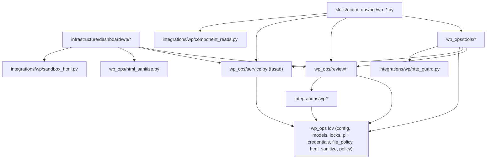

# Underhållbarhetsgranskning och refaktoreringsplan — WordPress ops

**Purpose:** Samlad, verifierad underhållbarhetsgranskning och konkret refaktoreringsplan för hela WordPress ops-ytan (`skills/ecom_ops/wp_ops/`, `skills/ecom_ops/integrations/wp_*.py`, `infrastructure/dashboard/wp_routes.py`, WP-delar i `skills/ecom_ops/bot/`, WP-skill cards samt `tests/test_wp_*.py`).  
**Audience:** Kodagenter, utvecklare och Oscar (projektägare / godkännare).  
**Read this first:** [`docs/CURRENT_STATE.md`](../CURRENT_STATE.md), [`AGENTS.md`](../../AGENTS.md), [`docs/DOC_STYLE.md`](../DOC_STYLE.md), [`docs/WORDPRESS_OPS.md`](../WORDPRESS_OPS.md), [`docs/WOO_WORDPRESS.md`](../WOO_WORDPRESS.md), [`docs/DEVELOPER_GUIDE.md`](../DEVELOPER_GUIDE.md).

**Document status:** Enbart läsande kodgranskning och refaktoreringsförslag (2026-11-26). Ingen produktionskod, konfiguration eller testfil har ändrats, och inga live-anrop mot externa tjänster har körts. Samtliga mänskliga gates enligt [`docs/CURRENT_STATE.md`](../CURRENT_STATE.md) (A1 live soak, FU9 auto-send, live SSH-pilot och `AZOM_WP_SANDBOX=0` som standard) gäller oförändrade.

---

## Glossary

| Term | Betydelse i denna rapport |
|------|---------------------------|
| **Compatibility facade** | En tunn modul på den gamla importvägen (t.ex. `wp_ops/agent_tools.py` eller `integrations/wp_live_preview.py`) som återexporterar publika och testimporterade symboler samt behåller anropsvägar för `monkeypatch`-mål under migreringen. |
| **Fail-closed** | Okända, ogiltiga eller saknade miljöflaggor, parametrar, behörigheter eller artefakter nekar åtgärd — faller aldrig tyst över till live-anrop eller skrivning. |
| **HITL** | *Human-in-the-loop*: explicit mänsklig godkännandeknapp/POST-åtgärd med hash-pinning krävs för staging (`wpfile:stage:fe-...`, `wpreview:stage:wr-...`) och WP-utkast (`wpreview:push_draft:wr-...`). Produktion (`BackupNotVerified`) och återställning (`RestoreNotInMvp`) förblir stängda. |
| **Monkeypatch-mål** | Ett modul- eller klassattribut som tester ersätter med `monkeypatch.setattr("mod.namn", ...)`. Enbart re-export räcker inte: anropsstället måste också slå upp namnet via den patchade modulen (eller så uppdateras testen i samma commit). |
| **RBAC** | Rollbaserad åtkomstkontroll via `WP_OPS_READ`, `WP_OPS_OPERATE`, `WP_OPS_ADMIN`, `WP_OPS_RESTORE` och `CODE_EDIT` (Jonatan = `viewer`, agent = `operator`, Oscar = `full_admin`). |
| **Ruff `C901`** | McCabe cyklomatisk komplexitet beräknad med `ruff check --select C901`. Används genomgående i hela rapporten för jämförbara tal mellan områden. |
| **`wr-*` / `fe-*`** | Isolerad flerfils-arbetsyta (`wr-...`, hanterad av `ReviewPlans`) respektive enfils-diffplan (`fe-...`, hanterad av `FileChangeOps`). |
| **Säkerhetsflaggor** | `AZOM_USE_MOCK` (standard mock), `AZOM_WP_FILES_SSH` (skrivskyddad nyckel-SFTP, av som standard), `AZOM_WP_LIVE_PREVIEW` (skrivskyddad live-preview, av som standard), `AZOM_WP_SANDBOX` (lokal loopback-sandbox, av som standard) och `AZOM_WPORG_INTEL` (extern WP.org-metadata, av som standard). |

---

## 1. Sammanfattning

Granskningen omfattade hela WordPress ops-kodbasen i fem oberoende delområden (`AT`, `RV`, `CO`, `IN`, `SF`) som därefter kontrollverifierades mot källkod, AST, Ruff `C901` och `pytest --collect-only` (**1 226** tester totalt, varav **342** i **23** `tests/test_wp_*.py`-filer på 15 984 rader).

**Nuläge i siffror:**
- `skills/ecom_ops/wp_ops/`: 27 filer (~24 143 LOC), dominerat av tre monoliter: `agent_tools.py` (8 178 LOC), `review_plan.py` (3 294 LOC) och `service.py` (1 618 LOC, med 24 lata importcykler).
- `skills/ecom_ops/integrations/`: 9 WP-relaterade filer (6 910 LOC), med `wp_live_preview.py` (2 589 LOC) och `wp_local_runtime.py` (1 193 LOC, 44 % inbäddad PHP/SQL).
- Ytor & tester: `infrastructure/dashboard/wp_routes.py` (1 396 LOC), ~1 200+ LOC WP-lim inbakat i `bot/chat_agent.py` (3 954 LOC) och `bot/handlers.py` (3 693 LOC), 6 WP-skill cards + `ecom-ops/SKILL.md` samt 23 WP-testfiler med kraftig setup-duplicering.
- Befintlig `ruff check` passerar, men komplexitets- och arkitekturanalysen visar utbredd duplicering av säkerhetskritisk kod (HTML-sanering 3×, hemlighetsmaskering 4×, CSS-normalisering 2×, `AZOM_USE_MOCK`-tolkning med fail-open-avvikelse när flaggan saknas, rå `urllib` inne i `wp_ops/` och saknat fil-lås i `ReviewPlans.open()`).

### Högst värderade refaktoreringar (topp 8)

| ID | Vad | Varför | Effort | Risk |
|----|-----|--------|--------|------|
| **AT-01 + AT-02** | Dela upp `wp_ops/agent_tools.py` (8 178 LOC) i `wp_ops/tools/` med deklarativt `ToolSpec`/`@register_tool`-register och bryt PII-cirkelimporten via `wp_ops/pii.py`. | Eliminerar största monoliten (`WpAgentTools` 5 335 LOC / 88 metoder, `run_bounded_file_tool_loop` C901=125), 7-vägs verktygsregistrering, 46-grenars `_safe_tool_outcome` och schemadrift (`12288` vs `20480`). | L | M |
| **RV-01 + RV-02 + RV-06** | Dela upp `wp_ops/review_plan.py` (3 294 LOC, 68 metoder) i `wp_ops/review/`, lägg all planlagring under ett enhetligt fil-lås i `PlanStore` och inför publik read-model (`describe_site_plans`, `describe_plan`, `staging_readiness`). | Fixar bekräftad race-risk i `open()` (saknar `_store_file_lock()`), eliminerar 9× mutator-boilerplate, 2× filinläsning per anrop samt privata reach-ins från dashboard och bot. | L | H |
| **CO-01 + CO-03 + CO-04** | Inför `wp_ops/config.py` (fail-closed `is_mock_mode()`), `wp_ops/locks.py`, `wp_ops/policy.py` (`WpOpsPolicy`) samt extrahera `health.py` och `BackupService` ur `service.py` (1 618 LOC). | Täpper bekräftad `AZOM_USE_MOCK`-avvikelse (unset tolkades som live i `ssh_settings.py`, `wporg_intel.py`, `wp_files_ssh.py`, `wp_org_client.py`), bryter 24 lata importcykler och samlar RBAC/lås/audit på ett ställe. | L | M |
| **IN-01 + IN-02 + IN-07** | Dela upp `integrations/wp_live_preview.py` (2 589 LOC) i `integrations/wp/` (`http_guard.py`, `cdp_browser.py`, `sandbox_html.py`, `preview_scripts.py`, `preview_capture.py`, `png_composite.py`). | Tar bort 7 privata korsimporter mellan `wp_live_preview` och `wp_browser_smoke`, flyttar ut rå `urllib` ur `wp_ops/agent_tools.py` och täpper saknad `ProxyHandler({})`/redirect-pinning i `wp_org_client.py`. | L | M |
| **CO-02 + CO-05** | Dela `file_changes.py` (1 410 LOC) och `files.py` (760 LOC) i `file_paths.py`, `file_transport.py`, `file_policy.py`, `search.py` och `file_plans.py`; ena hemlighetsmaskering i `credentials.py`. | Avvecklar 141 privata anrop (`editor._*` 92× + 49×), utökar `FileTransport`-protokollet, tar bort `search()` C901=36 och stänger drift mellan 4 kopior av hemlighetsregexar samt 2 kopior av CSS-normalisering. | L | M |
| **SF-01 + SF-02 + RV-03** | Konsolidera HTML-sanering och preview-CSP i lövmodulen `wp_ops/html_sanitize.py` (med `guard_script_builder`-injektion) och dela `infrastructure/dashboard/wp_routes.py` (1 396 LOC) i `infrastructure/dashboard/wp/`. | Tar bort 3× duplicerad XSS-sanering, eliminerar regex-skrapning ur syntetisk HTML (`_build_canonical_guard_script`) och flyttar disk-/storage-läsningar bort från Flask-rutter. | L | M |
| **SF-03 + SF-04 + SF-05** | Extrahera `bot/wp_intents.py`, `bot/wp_session.py`, `bot/wp_handlers.py` och `bot/wp_turn.py` ur `chat_agent.py` (3 954 LOC), `handlers.py` (3 693 LOC), `site_content.py` och `change_clarifier.py`. | Stoppar regex-drift mellan `WP_CODE_INTENT_RE` och `_WP_CODE_FALLTHROUGH_RE`, tar bort 2 eftersläpande kopior av verktygsetiketter/kapabiliteter och lyfter ~1 200 LOC WP-lim ur generella botfiler. | L | H |
| **SF-09 + SF-10 + SF-07** | Flytta 23 `test_wp_*.py` till `tests/wp/` med `conftest.py`/`_helpers.py`, dela versionsnamngivna jättefiler (`toolbox_v3`, `toolchain_v2`, `etapp3`) efter funktion och fixa verifierad doc-/playbook-drift (`wp_page_review`, byte-gränser). | Minskar testsetup-duplicering över 15 984 LOC utan att försvaga en enda assertion, underlättar alla efterföljande refaktorerings-PR:er och stoppar att LLM-promptar/skills hänvisar till icke-existerande verktyg. | M | M |

---

## 2. Målstruktur

### Arkitekturbeslut och lösta tvärsnittskonflikter

För att undvika cirkulära importer, namnkrockar och duplicerade lövmoduler gäller följande fastställda beslut över alla fem delområden:

1. **Integrationspaket heter `integrations/wp/` — aldrig `integrations/wordpress/`** (`IN-09`): `tests/test_wp_ops.py:313-317` förbjuder strängen `"integrations.wordpress"` i `wp_ops/`, och `docs/WORDPRESS_OPS.md:18` skiljer innehållsklienten (`integrations/wordpress.py`) från driftadaptrarna.
2. **Sju I/O-fria lövmoduler direkt under `skills/ecom_ops/wp_ops/`:**
   - `wp_ops/config.py`: fail-closed `is_mock_mode()` (standard `True` när `AZOM_USE_MOCK` saknas) för `wp_ops/*`, `integrations/wp_files_ssh.py:418` och `integrations/wp_org_client.py:35` (`wordpress.py` och `woocommerce.py` lämnas oförändrade).
   - `wp_ops/pii.py`: nordisk PII-detektor (`contains_real_pii`), bryter cykeln `review_plan -> agent_tools` (behåller `WpAgentTools._contains_real_pii` som alias).
   - `wp_ops/html_sanitize.py`: enhetlig tagg-/event-/URL-strippning, `_AllowlistHtmlSanitizer`, `harden_preview_html(..., guard_script_builder=...)` och `preview_csp_header`. `dashboard/wp/preview_routes.py` injicerar `integrations/wp/sandbox_html.py:build_sandbox_guard_script` så `wp_ops/` aldrig importerar `integrations/wp/sandbox_html`.
   - `wp_ops/file_policy.py`: kanonisk `normalize_css_for_check`, `is_safe_pure_css_file`, `risk_for` och `production_deploy_block` (importeras av `html_sanitize.py` och `review/risk.py`).
   - `wp_ops/locks.py`: både `site_lock`/`hold_site` (in-process) och `advisory_file_lock` (`fcntl.flock`/`msvcrt.locking` för `ssh_settings.py` och `review/store.py`).
   - `wp_ops/credentials.py`: kanonisk `redact_secret_text` / `scrub_compact` som samtliga moduler delegerar till.
   - `wp_ops/store.py`: `WpOpsStore` + `atomic_write_text` (med Windows-retry och bevarade `store.os.replace`/`store.time.sleep`-anrop).
3. **HTTP-I/O-gränsen (`IN-07` + `AT-05`):** Rå `urllib.request` i `agent_tools._safe_site_get_json` flyttas till `integrations/wp/http_guard.py:fetch_site_rest_json` (med tunn delegeringsmetod kvar på `WpAgentTools` för instanspatchar i tester).
4. **Rekursiv säkerhetsvakt i tester:** I **första PR** som skapar `wp_ops/tools/` eller `wp_ops/review/` uppgraderas [`tests/test_wp_ops.py:315`](../../tests/test_wp_ops.py#L315) från `package.glob("*.py")` till `package.rglob("*.py")`.
5. **Kanoniskt publikt read-model-API på `ReviewPlans` (`RV-01` + `SF-01`/`SF-04`):** `describe_site_plans(...)`, `describe_plan(...)`, `staging_readiness(plan, *, changed_count=None)`, `verify_current_evidence(plan)` (med `_require_current_evidence`-alias för `test_wp_security_hardening.py:138`) och `safe_preview_html_path(data_dir, site_id, plan_id)` (bevarar N+1-garantin i `test_wp_dashboard.py:750-788`).
6. **Kanoniska metadata och sajtklient:** `wp_ops/tools/registry.py` äger verktygsetiketter och kapabilitetslistan (ersätter kopior i `chat_agent.py`); `integrations/wp/component_reads.py:wp_client_for_site` äger per-sajt `WordPressClient`-bindning (ersätter kopian i `bot/page_review_runtime.py`).

### Beroenderiktning mellan lager



### Föreslagen paketstruktur

```text
skills/ecom_ops/
├── wp_ops/
│   ├── __init__.py                  # Återexporterar WpOpsService
│   │
│   │  # --- Delade I/O-fria lövmoduler och policygrund ---
│   ├── config.py                    # NY: fail-closed is_mock_mode (default True), rest_reads_allowed,
│   │                                #     ssh_files_enabled, wporg_intel_live_enabled, data_dir_path, config_dir_path
│   ├── models.py                    # Site, parse_site, WpOpsResult, ok/fail-hjälpare, TypedDicts,
│   │                                # SITE_ID_RE, validate_files_root, validate_ssh_host, UTC-hjälpare
│   ├── locks.py                     # NY: site_lock, hold_site (tråd) + advisory_file_lock (fcntl/msvcrt)
│   ├── store.py                     # WpOpsStore + delad atomic_write_text (behåller store.os.replace/time.sleep)
│   ├── credentials.py               # BoundCredential, bind_credential, scrub_secrets + redact_secret_text, scrub_compact
│   ├── pii.py                       # NY: contains_real_pii, normalize_pii_text (bryter review_plan -> agent_tools)
│   ├── html_sanitize.py             # NY: _AllowlistHtmlSanitizer, sanitize_page_draft_html, sanitize_rich_html,
│   │                                #     _is_safe_url, _strip_tag_event_handlers, _neutralize_overlay_fragment,
│   │                                #     harden_preview_html(..., guard_script_builder=...), preview_csp_header
│   ├── policy.py                    # NY: WpOpsPolicy (RBAC + sajtuppslag + icke-blockerande lås + audit)
│   ├── file_paths.py                # NY: SLUG_RE, SEGMENT_RE, PLAN_ID_RE, PathRejected, TransportError,
│   │                                #     TRANSPORT_MESSAGES, resolve_file/dir, sensitive_relative, plan_expired
│   ├── file_policy.py               # NY: normalize_css_for_check, is_safe_pure_css_file, risk_for, production_deploy_block
│   ├── file_transport.py            # NY: utökat FileTransport-Protocol (list_entries, open_batch,
│   │                                #     read_css_search_bytes, create_bytes, is_ssh) + LocalTree
│   ├── source_scan.py               # NY: publik PHP-/källkodsskanner + semver-hjälpare
│   │
│   │  # --- Kärntjänster och offline-analys ---
│   ├── registry.py                  # load_sites, site_by_id, resolve_site_id_from_text (utan död as_public)
│   ├── ssh_settings.py              # Enade validerare, SshSettingsInput, atomic_write_text + advisory_file_lock
│   ├── connectors.py                # ProbeOutcome, Uptime/Rest Protocols & Mocks
│   ├── health.py                    # NY: HealthChecker (prober, streaks, incidenter, dedupe, sajtsummering)
│   ├── backup.py                    # BackupProvider, MockBackup, new_manifest + BackupService (drill + restore-nekande)
│   ├── search.py                    # NY: validate_safe_regex, search_texts, ComponentSearcher
│   ├── file_plans.py                # NY: FilePayloadStore, FileEditor, FileChangeOps (via WpOpsPolicy)
│   ├── code_index.py                # Symbolindexering (använder source_scan + credentials)
│   ├── static_checks.py             # Offline statiska kontroller (använder source_scan + credentials)
│   ├── woo_templates.py             # Woo-malljämförelse (använder source_scan)
│   ├── wporg_intel.py               # Komponent-intel (använder config + source_scan + credentials)
│   ├── theme_json.py                # Dekomponerad _apply_one
│   ├── playbooks.py                 # Fixad drift (ta bort fiktiv wp_page_review på rad 94, 100, 239, 368)
│   │
│   │  # --- Agentverktyg (ersätter monoliten agent_tools.py) ---
│   ├── tools/
│   │   ├── __init__.py              # Publika verktygsexporter
│   │   ├── types.py                 # ToolOutput, ToolLoopResult, ToolContext, budgetkonstanter, regexar
│   │   ├── registry.py              # ToolSpec, @register_tool, härledda scheman, FILE_TOOL_NAMES,
│   │   │                            # _WP_TOOL_LABELS, kapabilitetsmetadata och utfallsformaterare
│   │   ├── guides.py                # WP_DRIFT_TOOL_GUIDE, WP_TOOL_GUIDE
│   │   ├── validation.py            # Strikta argumentvaliderare, _utf8_window, _parse_tool_call, felhjälpare
│   │   ├── scrub.py                 # Tunna wrappers över wp_ops.credentials.redact_secret_text
│   │   ├── workspace_io.py          # authorize_editor_site, upsert_workspace_json
│   │   ├── context.py               # context_for_storage, context_matches, _valid_context, _expired
│   │   ├── progress.py              # _safe_tool_detail, tabellstyrd _safe_tool_outcome, _provenance_for, _review_notice
│   │   ├── loop_state.py            # LoopBudget, ReviewMetaTracker, AttachmentTracker, LoopResultBuilder
│   │   ├── loops.py                 # Delad loopmotor -> run_bounded_wp_tool_loop, run_bounded_file_tool_loop
│   │   ├── drift.py                 # wp_list_sites, status, backups, security, update/restore-preview-planer
│   │   ├── components.py            # active_live_theme, open_transport_batch, walk_component_tree,
│   │   │                            # overview, search, code_index, hierarchy, woo audit, intel, playbook, read_file
│   │   ├── workspace.py             # wr-* livscykel/redigering/kontroller + fe-* plandispatch
│   │   ├── html_parse.py            # HtmlMetaParser, ProductLinkParser, selektor- & JSON-LD-extraktion
│   │   ├── catalog.py               # wp_list_products, wp_get_product, prishjälpare (anropar fasadens _safe_site_get_json)
│   │   ├── pages.py                 # wp_list_pages, wp_get_page, wp_build_sample_data
│   │   ├── preview.py               # wp_fetch_page_html, wp_inspect_element, wp_preview_page
│   │   └── sandbox_edits.py         # wp_workspace_product_edit, wp_workspace_page_draft (via workspace_io + pii)
│   │
│   │  # --- Arbetsytor, granskningsplaner, overlay och sidgranskning ---
│   ├── review/
│   │   ├── __init__.py
│   │   ├── risk.py                  # review_risk, tree_risk, ORDER_RISK_RE, text_is_review_approval
│   │   ├── knowledge.py             # Tabellstyrd template_candidates (_TemplateRule) + hierarchy_candidates
│   │   ├── checks.py                # Flyttad från review_checks.py (importerar ORDER_RISK_RE)
│   │   ├── runner.py                # Flyttad från review_runner.py (+ public_sandbox_record)
│   │   ├── workspace_io.py          # PLAN_ID/SLUG, ReviewError, Verified*, workspace_root, tree_hash, manifest
│   │   ├── component_reader.py      # Enad LocalTree/SFTP-vandrare: read_local/site_component, read_theme_woo_files
│   │   ├── workspace_ops.py         # read/list/diff/patch/create/apply_work_changes/bulk_replace/theme_json
│   │   ├── scaffolds.py             # child_skeleton, plugin_skeleton, tabellstyrd scaffold_work
│   │   ├── store.py                 # PlanStore: konsekvent _STORE + advisory_file_lock, get_or_expire, public_plan
│   │   ├── check_executor.py        # run_checks, _run_sandbox_catalog, publik verify_current_evidence
│   │   ├── preview_coordinator.py   # build_overlay_html, live_preview, baseline-återanvändning, jämförelser,
│   │   │                            # safe_preview_html_path, artefakter
│   │   ├── deploy.py                # approve_staging, request_production, push_page_draft (använder wp_ops/pii.py)
│   │   ├── plans.py                 # Smal ReviewPlans-orkestrerare + _mutate_workspace + publik read-model
│   │   │                            # (describe_site_plans, describe_plan, staging_readiness)
│   │   ├── preview/
│   │   │   ├── shell.py             # SiteShell, extract_site_shell, compose_standalone_page, span-sökning
│   │   │   ├── diff_overlay.py      # OverlayHunk/Result, i18n-expansion, CSS-injektion, apply_overlay
│   │   │   └── product_overlay.py   # Tabellstyrd apply_product_edits_overlay
│   │   └── page/
│   │       ├── intent.py            # is_page_review, extract_page_review_target
│   │       ├── context.py           # ReviewContext, prepare_context, not_run_rendered_dom (enad SLUG)
│   │       ├── steps.py             # Dekomponerad step_home, step_content, step_sources, step_preview
│   │       ├── loop.py              # PAGE_REVIEW_TOOLS, ORDER_TOOL_NAMES, execute_page_review_tool, loop
│   │       └── formatters.py        # _step_outcome, _report, _layers, _format
│   │
│   │  # --- Tunna kompatibilitetsfasader (re-exports + monkeypatch-hooks) ---
│   ├── agent_tools.py               # ~150-250 LOC fasad: WpAgentTools + 27 produktions-/testsymboler
│   ├── service.py                   # ~220 LOC fasad: WpOpsService + WpOpsResult/_site_lock/_drills_for/restore
│   ├── files.py                     # Fasad över file_paths + file_transport + FileEditor
│   ├── file_changes.py              # Fasad över file_policy + search + file_plans + config.rest_reads_allowed + FILE_TOOL_NAMES
│   ├── review_plan.py               # Fasad över review/* (bevarar review_plan.run_catalog-uppslag)
│   ├── review_workspace.py          # Fasad över review/{workspace_io,component_reader,workspace_ops,scaffolds}
│   ├── review_knowledge.py          # Fasad över review/knowledge.py
│   ├── review_checks.py             # Fasad över review/checks.py
│   ├── review_runner.py             # Fasad över review/runner.py
│   ├── page_review.py               # Fasad över review/page/{context,steps}
│   ├── page_review_loop.py          # Fasad över review/page/{loop,formatters}
│   ├── page_review_intent.py        # Fasad över review/page/intent.py
│   └── preview_overlay.py           # Fasad över html_sanitize + review/preview/*
│
├── integrations/
│   ├── __init__.py                  # Oförändrade publika exporter
│   ├── _http_transport.py           # NY: delad HttpTransport Protocol (med requires_auth) + parameteriserad RequestsTransport
│   ├── wordpress.py                 # Innehållsklient (behålls separat från integrations/wp/!)
│   ├── woocommerce.py               # Woo REST-klient (importerar _http_transport)
│   ├── wp/                          # WP-driftsintegrationer (ALDRIG integrations/wordpress/)
│   │   ├── __init__.py              # Minimal — ingen ivrig import av WordPressClient eller paramiko
│   │   ├── http_guard.py            # SSRF/host/redirect-vakt, BLOCKED_WP_PATHS, STATIC_ASSET_HOSTS,
│   │   │                            # fetch_live_html, fetch_site_rest_json
│   │   ├── cdp_browser.py           # LoopbackCdpClient (+ .eval_json), HeadlessBrowserSession,
│   │   │                            # ReadOnlyFetchInterceptor, collect_cdp_diagnostics, PNG_MAGIC/png_dimensions
│   │   ├── preview_scripts.py       # Inbäddade JS-fokus/inspektionsskript med en delad DOM-hjälpsnutt
│   │   ├── sandbox_html.py          # build_interactive_sandbox_html, build_sandbox_guard_script
│   │   ├── preview_capture.py       # capture_preview, inspect_element, _finalize_summary
│   │   ├── png_composite.py         # build_comparison_composite + ren Python PNG-kodek & 5x7-font
│   │   ├── process_env.py           # build_php_child_env, probe_subprocess_env, terminate_process_tree,
│   │   │                            # pick_loopback_port, utc_now_iso
│   │   ├── sandbox_sqlite.py        # init_sqlite_db, php_serialize_list
│   │   ├── local_runtime.py         # LocalWordPressSandbox, resolve_local_runtime, make_local_sandbox_gate
│   │   ├── sandbox_smoke.py         # run_browser_render, run_vertical_theme_render, run_vertical_plugin_smoke
│   │   ├── sftp_transport.py        # SshFileTransport (_read_bounded, _sftp_errors), build_file_transport
│   │   ├── runtime_fetch.py         # Pinnad WP/PHP-nedladdare (med ProxyHandler({}))
│   │   ├── php_lint.py              # resolve_php_binary, run_php_lint
│   │   ├── wporg_client.py          # fetch_wporg_json (ProxyHandler({}) + host-pinnade redirects + is_mock_mode())
│   │   ├── component_reads.py       # wp_client_for_site, load_theme_rows, load_plugin_rows
│   │   └── templates/               # Externa PHP/SQL-mallar extraherade ur wp_local_runtime.py
│   │       ├── db_dropin.php
│   │       ├── egress_guard.php
│   │       ├── wp_config.php.tmpl
│   │       ├── router.php.tmpl
│   │       └── synthetic_theme/{style.css, functions.php, index.php}
│   │  # --- Tunna kompatibilitetsfasader ---
│   ├── wp_live_preview.py           # Re-exporterar 28 symboler + delegeringskrokar för patchar
│   ├── wp_browser_smoke.py          # Fasad över cdp_browser + sandbox_smoke
│   ├── wp_local_runtime.py          # Fasad över process_env + sandbox_sqlite + local_runtime
│   ├── wp_files_ssh.py              # Fasad över sftp_transport (bevarar socket/paramiko-patchytor)
│   ├── wp_review_process.py         # Fasad över php_lint
│   ├── wp_runtime_fetch.py          # Fasad över runtime_fetch
│   ├── wp_org_client.py             # Fasad över wporg_client
│   └── wp_component_reads.py        # Fasad över component_reads
│
└── bot/
    ├── wp_intents.py                # NY: enad källa för WP-intent- & vägransregexar
    ├── wp_session.py                # NY: active_wp_review, wp_ops_context, hash-rensning
    ├── wp_turn.py                   # NY: WP-turstillstånd, policysammansättning, loopdispatch
    ├── wp_handlers.py               # NY: /wp-kommandon, wpfile:*/wpreview:*-callbacks, hash-pinning
    ├── page_review_runtime.py       # Delad run_page_review_turn() + delegerar klient till integrations/wp/component_reads.py
    ├── page_review_job.py           # Tunn jobbwrapper runt run_page_review_turn()
    └── chat_agent.py / handlers.py / site_content.py / change_clarifier.py  # Betydligt slankare + kompatibilitetsre-exports

infrastructure/dashboard/
├── wp_routes.py                     # Tunn fasad som re-exporterar register_wp_routes
└── wp/                              # Strikt tillståndslösa undermoduler (säkra vid test-reload)
    ├── __init__.py
    ├── auth_helpers.py              # En _current_actor() + RBAC-predikat + _wp_service()
    ├── site_routes.py               # /wp, /wp/<id>, check, backup, restore-drill, ssh
    ├── file_routes.py               # /wp/<id>/files, propose, apply, plan, deploy
    ├── review_routes.py             # /wp/<id>/reviews/<plan_id> + enhetlig _run_review_action()
    └── preview_routes.py            # /reviews/<id>/preview (injicerar build_sandbox_guard_script) & /artifact/<name>

docs/
├── WP_SKILL_GUARDRAILS.md           # NY: delade budget-/HITL-/untrusted-bytes-/URL-blockregler för alla 6 WP-skill cards
└── WORDPRESS_OPS.md                 # Synkad med faktiska budget-/läsgränser (28 KiB / 80 KiB / 20 480 B)

tests/wp/                            # Ingen __init__.py; globalt unika test_wp_*-filnamn
├── conftest.py                      # Icke-autouse: wp_env, mock_wp_service, wp_service_tools,
│                                    # mock_child_theme, funktionsskopad dashboard_app/auth, audit_path, actor_maps
├── _helpers.py                      # REPO_ROOT, MOCK_REGISTRY, tool_call, write_mock_component, site_row, make_png
└── test_wp_<feature>.py             # 23 flyttade + funktionsuppdelade moduler (ersätter v2/v3/etapp3/recovery)
```

---

## 3. Fynd per område

Nedan redovisas samtliga verifierade fynd, avduplicerade mellan delområden (tvärsnittsproblem ägs av en kanonisk modul och korsrefereras där de berörs). Alla komplexitetstal använder Ruff McCabe `C901`.

### 3.1 Agentverktyg (`AT-*`) — `wp_ops/agent_tools.py` (8 178 LOC)

- **AT-01 — Monolitisk gudfil och gudklass (`WpAgentTools`)** (`Effort: L`, `Risk: M`)  
  Plats: [`skills/ecom_ops/wp_ops/agent_tools.py:1-8178`](../../skills/ecom_ops/wp_ops/agent_tools.py#L1-L8178) (`WpAgentTools` L1032-6366).  
  **Problem:** En enda fil på 8 178 rader (368 KB); `WpAgentTools` omfattar 5 335 rader och 88 metoder (30 >50 rader, 18 >100 rader, 5 >200 rader). 22 funktioner/metoder har `C901 > 20` (topp: `run_bounded_file_tool_loop`=125, `_safe_tool_outcome`=68, `_execute_file`=48, `_get_product`=48, `_extract_product_detail_from_html`=41, `_fetch_page_html`=40, `_build_sample_data`=38, `_workspace_product_edit`=36, `_execute`=34, `_execute_workspace`=34). Sex skilda domäner samsas på samma klass.  
  **Förslag:** Dela upp i `skills/ecom_ops/wp_ops/tools/` med tunn `agent_tools.py`-fasad som behåller `WpAgentTools.execute()` som enda auditerad ingångspunkt.  
  **Berörda tester & räcken:** 18 testfiler som importerar `agent_tools`; `AuditUnavailable` fail-closed, RBAC, mock-first, SFTP-only.

- **AT-02 — 7-vägs fragmenterad verktygsregistrering, jätteswitchar och schemadrift** (`Effort: M`, `Risk: M`)  
  Plats: [`skills/ecom_ops/wp_ops/agent_tools.py:115-278`](../../skills/ecom_ops/wp_ops/agent_tools.py#L115-L278), [`376-919`](../../skills/ecom_ops/wp_ops/agent_tools.py#L376-L919), [`1082-1470`](../../skills/ecom_ops/wp_ops/agent_tools.py#L1082-L1470), [`1607-1820`](../../skills/ecom_ops/wp_ops/agent_tools.py#L1607-L1820), [`6369-6684`](../../skills/ecom_ops/wp_ops/agent_tools.py#L6369-L6684), [`7133-7157`](../../skills/ecom_ops/wp_ops/agent_tools.py#L7133-L7157).  
  **Problem:** Att lägga till/ändra ett av de 54 verktygen (`8 WP + 46 FILE`, med `wp_read_theme_plugin_file` gränslande mellan båda med särfall på L1094, L6924, L7925) kräver synkade ändringar på upp till 8 ställen (`WP_TOOL_SCHEMAS`/`FILE_TOOL_SCHEMAS` 604L, 7 verktygsmängder 115L, `_WP_TOOL_LABELS` 56L, `_safe_tool_outcome` 205L / 46 `if name ==`-grenar / C901=68, `_execute`/`_execute_file`/`_execute_workspace` 602L, samt `WP_TOOL_GUIDE`). Drift finns redan: `WP_TOOL_SCHEMAS["wp_read_theme_plugin_file"]["properties"]["limit"]["maximum"]` är `12288` (L167), medan `_FILE_READ_MAX` (L294, L1154) och guiden (L970) tillåter `20480`.  
  **Förslag:** Inför `wp_ops/tools/registry.py` med fryst `ToolSpec` + `@register_tool(...)` och härled scheman, mängder (`FILE_TOOL_NAMES` flyttas hit från `file_changes.py`), `_WP_TOOL_LABELS`, kapabiliteter (ersätter kopior i `chat_agent.py`, se `SF-03`) och tabellstyrd `_safe_tool_outcome`. Synka `limit.maximum` mot `_FILE_READ_MAX`.

- **AT-03 — Överdimensionerade, duplicerade verktygsloopar** (`Effort: M`, `Risk: M`)  
  Plats: [`skills/ecom_ops/wp_ops/agent_tools.py:6698-6955`](../../skills/ecom_ops/wp_ops/agent_tools.py#L6698-L6955) (258L, C901=27) och [`7160-8000`](../../skills/ecom_ops/wp_ops/agent_tools.py#L7160-L8000) (`run_bounded_file_tool_loop` 785L, C901=125).  
  **Problem:** `run_bounded_file_tool_loop` kapslar in 8 nästlade funktioner som muterar ~15 `nonlocal`-variabler och kopierar styrkö-hantering, aktörskontroll + tidsmätt `execute()` + byte-kapning, `ProgressEvent`-utsändning (11 ställen) och 21 `ToolLoopResult(...)`-konstruktioner från `run_bounded_wp_tool_loop`.  
  **Förslag:** Extrahera `tools/loop_state.py` (`LoopBudget`, `ReviewMetaTracker`, `AttachmentTracker`, `LoopResultBuilder`) och `tools/loops.py` med en `LoopPolicy`-parameteriserad motor (<120L per orkestrerare). Bevara `wp_playbook`-undantaget (L7803), `stage_plan_id`-invalidering vid mutation (L7875-7881) och untrusted-wrapping.

- **AT-04 — Upprepad hanterar-boilerplate (validering, RBAC/sajtvakt, maskering, JSON-upsert)** (`Effort: M`, `Risk: L`)  
  Plats: [`skills/ecom_ops/wp_ops/agent_tools.py:1124-2588`](../../skills/ecom_ops/wp_ops/agent_tools.py#L1124-L2588), [`4345-4532`](../../skills/ecom_ops/wp_ops/agent_tools.py#L4345-L4532), [`5091-5300`](../../skills/ecom_ops/wp_ops/agent_tools.py#L5091-L5300), [`5488-6029`](../../skills/ecom_ops/wp_ops/agent_tools.py#L5488-L6029).  
  **Problem:** 167 `ToolOutput(_error(...))`-returer, 117 `InvalidToolArguments`, 139 `arguments.get(...)`, 2× radintervallvalidering, 13× `editor = self.service._file_editor(); editor._site(...); editor.need(...)`, 3-vägs hemlighetsmaskering (överlappar `CO-05`) samt identisk arbetsyte-JSON-upsert i `_workspace_product_edit` (L4440-4505) och `_workspace_page_draft` (L5242-5269).  
  **Förslag:** Skapa `tools/validation.py`, `tools/scrub.py` (delegerar till `wp_ops/credentials.py`) och `tools/workspace_io.py` (`authorize_editor_site`, `upsert_workspace_json`).

- **AT-05 — Inbäddad katalog-/sid-REST-kaskad, HTML-skrapning, utkast och PII-cirkelimport** (`Effort: M`, `Risk: M`)  
  Plats: [`skills/ecom_ops/wp_ops/agent_tools.py:2706-5300`](../../skills/ecom_ops/wp_ops/agent_tools.py#L2706-L5300) (2 595L — 32 % av filen).  
  **Problem:** Innehåller två inline-`HTMLParser`-klasser, regex-selektorextraktion (C901=21), JSON-LD-skrapning (181L, C901=41), 4-stegs REST-kaskad kopierad över 4 metoder, syntetisk datagenerator (172L, C901=38), rå `urllib.request.build_opener` (L3490-3545 — som bara passerade `test_wp_ops.py:316` eftersom `opener.open()` inte nämner `"urlopen"`) samt nordisk PII-detektor (L5037-5089) som `review_plan.py:2319,2386` importerar cirkulärt.  
  **Förslag:** Dela upp i `wp_ops/pii.py` (delad lövmodul, behåll `WpAgentTools._contains_real_pii`-alias), `tools/html_parse.py`, `tools/catalog.py`, `tools/pages.py`, `tools/preview.py` och `tools/sandbox_edits.py`. Flytta all HTTP-I/O från `_safe_site_get_json` till `integrations/wp/http_guard.py:fetch_site_rest_json` (`IN-07`) bakom en tunn delegeringsmetod på `WpAgentTools` så instanspatchar fortsätter fungera.

- **AT-06 — Duplicerad aktiv-tema-uppslagning och komponentträdsvandring** (`Effort: S`, `Risk: M`)  
  Plats: [`skills/ecom_ops/wp_ops/agent_tools.py:2368-2676`](../../skills/ecom_ops/wp_ops/agent_tools.py#L2368-L2676), [`5406-6112`](../../skills/ecom_ops/wp_ops/agent_tools.py#L5406-L6112).  
  **Problem:** Live-REST-skanning efter aktivt tema upprepas **5×**; `open_batch()` + BFS-vandring upprepas **5×**. Dessutom gissar `_walk_component_tree` (L5442, L5477) `is_dir = Path(name).suffix == ""` och felklassificerar ändelselösa filer som `LICENSE`/`Makefile`, medan `_read_installed_index_files` (L2404) korrekt använder `transport.list_entries()`.  
  **Förslag:** Extrahera `tools/components.py` med `active_live_theme(...)`, `open_transport_batch(transport)` och enhetlig `walk_component_tree(...)` via `list_entries()`.

- **AT-07 — Död kod, redundanta inline-importer och doc-drift** (`Effort: S`, `Risk: L`)  
  Plats: [`skills/ecom_ops/wp_ops/agent_tools.py:167`](../../skills/ecom_ops/wp_ops/agent_tools.py#L167), [`291-294`](../../skills/ecom_ops/wp_ops/agent_tools.py#L291-L294), [`306-309`](../../skills/ecom_ops/wp_ops/agent_tools.py#L306-L309), [`3099-3133`](../../skills/ecom_ops/wp_ops/agent_tools.py#L3099-L3133), [`5049-5050`](../../skills/ecom_ops/wp_ops/agent_tools.py#L5049-L5050); [`docs/WORDPRESS_OPS.md:42,140,152`](../WORDPRESS_OPS.md#L42).  
  **Problem:** `_contains_non_synthetic_email` (L5049-5050) har 0 anropare; `_validate_focus_fallback` (L3099-3133) + `_PREVIEW_FOCUS_SELECTOR_RE` (L307-309) duplicerar alltid tillgängliga `wp_live_preview.validate_focus_options`; 7 inline-importer återimporterar redan toppimporterade symboler (`_scrub_search_text`, `bind_credential`, `ReviewError`); `WORDPRESS_OPS.md` anger föråldrade gränser (`16 KiB / 48 KiB` och `12288` vs faktiska `28_672 / 81_920` och `20480`).  
  **Förslag:** Ta bort död kod och redundanta inline-importer; synka `WP_TOOL_SCHEMAS` och `docs/WORDPRESS_OPS.md`.

- **AT-08 — Kompatibilitetskontrakt för uppdelning & rekursiv säkerhetsvakt** (`Effort: S`, `Risk: H om förbisett / L vid efterlevnad`)  
  Plats: [`skills/ecom_ops/wp_ops/agent_tools.py`](../../skills/ecom_ops/wp_ops/agent_tools.py), [`tests/test_wp_ops.py:313-317`](../../tests/test_wp_ops.py#L313-L317).  
  **Problem:** **22** unika symboler importeras direkt av 18 testfiler och **11** av 5 produktionsfiler (**27** unika totalt), därtill 6 modul-monkeypatchar och 7 privata instansmetoder. Dessutom skannar `test_package_has_no_shell_or_http_client` (`test_wp_ops.py:315`) enbart `package.glob("*.py")` och skulle missa underpaketet `wp_ops/tools/`.  
  **Förslag:** Uppgradera `test_wp_ops.py:315` till `package.rglob("*.py")` i första PR med underpaket; bevara re-exports och patch-hooks på fasaden (se tabell i avsnitt 5).

---

### 3.2 Gransknings-, sidgransknings- och preview-kluster (`RV-*`) — 9 filer (8 417 LOC)

Klustret blandar två skilda arbetsflöden under namnet `review`: isolerade `wr-*`-arbetsytor (6 963 LOC) och skrivskyddad startside-/sidkällkodsgranskning `wp_page_review_*` (1 454 LOC).

- **RV-01 — Dela upp `ReviewPlans` gudklass (68 metoder) och inför publikt read-model-API** (`Effort: L`, `Risk: H`)  
  Plats: [`skills/ecom_ops/wp_ops/review_plan.py:230-3030`](../../skills/ecom_ops/wp_ops/review_plan.py#L230-L3030) (fil 3 294L; `ReviewPlans` 2 801L, **68 metoder**: 37 publika, 31 privata).  
  **Problem:** Äger 7 skilda ansvar: JSON-lagring/lås, livscykel (`open` 123L / C901=12, `fork` 137L / C901=16 med 50L kopierad initiering), 9× identisk arbetsytemutations-boilerplate (L577-1161, 585L), kontrollkörning (`run_checks` 187L / C901=29), live preview (729L), HITL-deploy (`approve_staging` 128L / C901=29, `push_page_draft` 158L / C901=17), samt lagerbrott (importerar `WpAgentTools._contains_real_pii` uppåt; `wp_routes.py:815` och `bot/handlers.py:272` anropar privata `_safe_preview_html_path` respektive `_require_current_evidence`).  
  **Förslag:** Dela upp i `wp_ops/review/{store,risk,check_executor,preview_coordinator,deploy,plans}.py` med delad `_mutate_workspace`-hjälpare och publika metoderna `describe_site_plans(...)`, `describe_plan(...)`, `staging_readiness(plan, *, changed_count=None)`, `verify_current_evidence(plan)` och `safe_preview_html_path(data_dir, site_id, plan_id)`. Behåll `dict`-returtyp på `push_page_draft` under uppdelningen och behåll `review_plan.run_catalog`-uppslag via fasaden (11 testpatchar).

- **RV-02 — Dekomponera överdimensionerad preview-orkestrering och dubblettladdare** (`Effort: M`, `Risk: M`)  
  Plats: [`skills/ecom_ops/wp_ops/review_plan.py:1351-1936`](../../skills/ecom_ops/wp_ops/review_plan.py#L1351-L1936), [`3033-3069`](../../skills/ecom_ops/wp_ops/review_plan.py#L3033-L3069).  
  **Problem:** `live_preview()` (336L, **C901=44**) blandar 8 faser och `build_overlay_html()` (195L, **C901=33**) blandar fristående `page_draft.json`-komposition med live-overlay-diffar. `_load_product_edits()` och `_load_page_draft()` är 100 % identiska utom filnamnet. Fyra inline-`inspect.signature`-block upprepas för snäva test-lambdor.  
  **Förslag:** Lägg i `review/preview_coordinator.py`, dela i 5 stegfunktioner, ersätt båda laddarna med `_load_workspace_json(work_dir, filename)` och konsolidera signaturkollen i en hjälpare `_call_with_supported_kwargs(...)`. Fortsätt slå upp `fetch_live_html`/`capture_preview` genom `ecom_ops.integrations.wp_live_preview`.

- **RV-03 — Dela `preview_overlay.py` och konsolidera HTML-sanerarna** (`Effort: M`, `Risk: M`)  
  Plats: [`skills/ecom_ops/wp_ops/preview_overlay.py:1-1285`](../../skills/ecom_ops/wp_ops/preview_overlay.py#L1-L1285).  
  **Problem:** `_PageDraftHtmlSanitizer` (124L) och `_SafeRichHtmlSanitizer` (59L) duplicerar samma `HTMLParser`-stackmaskin; `apply_product_edits_overlay()` (216L, **C901=29**) upprepar samma span-ersättningsmönster i 6 grenar; `_normalize_css_for_security()` (L53-55, L204-219) är byte-för-byte identisk med `file_changes._normalize_css_for_check`; 5 XSS-regexar (L56-69, L222-243) är identiska med `wp_live_preview.py:165-178`.  
  **Förslag:** Flytta sanering till den delade lövmodulen `wp_ops/html_sanitize.py` (en parameteriserad `_AllowlistHtmlSanitizer`, importerar `wp_ops/file_policy.py:normalize_css_for_check`) och dela resten i `review/preview/{shell,diff_overlay,product_overlay}.py` (tabellstyrd `_patch_element_field`) bakom `preview_overlay.py`-fasaden.

- **RV-04 — Dela `review_workspace.py` och avduplicera transportvandrare samt patch/create** (`Effort: M`, `Risk: M`)  
  Plats: [`skills/ecom_ops/wp_ops/review_workspace.py:1-1425`](../../skills/ecom_ops/wp_ops/review_workspace.py#L1-L1425), [`review_plan.py:3262-3279`](../../skills/ecom_ops/wp_ops/review_plan.py#L3262-L3279).  
  **Problem:** `read_site_component()` (75L, **C901=21**) och `read_theme_woo_files()` (132L, **C901=35**) duplicerar `LocalTree`/SFTP-vandring; `patch_work_file()`/`create_work_file()` duplicerar `apply_work_changes()` (**200L, C901=50**) och kringgår `_resolve_work_target()`; `bulk_replace_work()` (**C901=22**) och `scaffold_work()` (**168L, C901=18**) är överdimensionerade; unified-diff-loopen dupliceras i `review_plan._unified` (som dessutom saknar `sensitive_relative()`-filtrering!).  
  **Förslag:** Dela i `review/{workspace_io,component_reader,workspace_ops,scaffolds}.py` bakom `review_workspace.py`-fasad och dela `unified_diff_text` med `review/plans.py`.

- **RV-05 — Dela sidgranskningsklustret (`page_review*`) och fixa slug-regex-drift** (`Effort: M`, `Risk: L`)  
  Plats: [`skills/ecom_ops/wp_ops/page_review.py:24,299-943`](../../skills/ecom_ops/wp_ops/page_review.py#L24), [`page_review_loop.py:92-471`](../../skills/ecom_ops/wp_ops/page_review_loop.py#L92-L471), [`page_review_intent.py:1-40`](../../skills/ecom_ops/wp_ops/page_review_intent.py#L1-L40).  
  **Problem:** `step_home()` (267L, **C901=54**), `step_sources()` (133L, **C901=26**) och `step_preview()` (141L, **C901=11**) är svåröverskådliga; samma `rendered_dom`-dict (not-run) upprepas **4×**; `page_review_loop.py` blandar körloop och 200L svensk rapportformatering. **Verifierad bugg/drift:** `page_review.py:24` tillåter inte `_` i `_SLUG` (`^[a-z0-9][a-z0-9-]{0,60}$`), medan övriga `wp_ops` (`review_workspace.py:37`, `files.py:25`, `agent_tools.py:176`) tillåter understreck — teman/plugins med `_` avvisas tyst som `active_theme_unknown`.  
  **Förslag:** Dela i `review/page/{intent,context,steps,loop,formatters}.py`, inför en `not_run_rendered_dom()`-fabrik och synka tema-/plugin-slug-regexen med `wp_ops/file_paths.py:SLUG_RE`.

- **RV-06 — Fixa saknat fil-lås i `ReviewPlans.open()` och dubbla JSON-inläsningar** (`Effort: S`, `Risk: M`)  
  Plats: [`skills/ecom_ops/wp_ops/review_plan.py:350-359`](../../skills/ecom_ops/wp_ops/review_plan.py#L350-L359), [`744-750`](../../skills/ecom_ops/wp_ops/review_plan.py#L744-L750), [`1859-1862`](../../skills/ecom_ops/wp_ops/review_plan.py#L1859-L1862), [`2057-2092`](../../skills/ecom_ops/wp_ops/review_plan.py#L2057-L2092), [`2714-2837`](../../skills/ecom_ops/wp_ops/review_plan.py#L2714-L2837).  
  **Problem:** `open()` (L350) muterar `wp_review_plans.json` under `with _STORE:` **utan** `_store_file_lock()`, till skillnad från `fork()` och `_replace()` — samtidiga anrop från bot och dashboard kan krocka och tappa en planrad. `show()`, `workspace_status()` och `preview_html_file()` anropar `_row()` **två gånger** per läsning. Cross-platform `fcntl`/`msvcrt`-låsning dupliceras mot `ssh_settings.py:609-636`.  
  **Förslag:** Samla all planpersistens i `review/store.py` (`PlanStore`) över `wp_ops/locks.py:advisory_file_lock` med fast låsordning (`site_lock -> plan_lock -> _STORE -> advisory_file_lock`) och engångsinläsning i `get_or_expire()`.

- **RV-07 — Tabellstyrd `template_candidates()` i `review_knowledge.py`** (`Effort: S`, `Risk: L`)  
  Plats: [`skills/ecom_ops/wp_ops/review_knowledge.py:63-439`](../../skills/ecom_ops/wp_ops/review_knowledge.py#L63-L439).  
  **Problem:** `template_candidates()` är en 312-raders 21-grenars `if/elif`-kedja (**C901=45**) som duplicerar startsideregler från `hierarchy_candidates()`.  
  **Förslag:** Flytta till `review/knowledge.py` och ersätt med en deklarativ `_TemplateRule`-tabell (~110L data + ~40L ren logik) bakom `review_knowledge.py`-fasad.

- **RV-08 — Konsolidera orderrisk-regex och sandbox-postfabriker** (`Effort: S`, `Risk: L`)  
  Plats: [`skills/ecom_ops/wp_ops/review_plan.py:86-90,2828-2834,2975-2990`](../../skills/ecom_ops/wp_ops/review_plan.py#L86-L90), [`review_checks.py:17`](../../skills/ecom_ops/wp_ops/review_checks.py#L17), [`review_runner.py:66-86`](../../skills/ecom_ops/wp_ops/review_runner.py#L66-L86).  
  **Problem:** Identisk orderrisk-regex i `review_plan.py` och `review_checks.py`; standardschema för sandbox-poster hårdkodat på 3 ställen. (`review_checks.py` och `review_runner.py` är i övrigt välskrivna och behöver bara flyttas.)  
  **Förslag:** Dela `ORDER_RISK_RE` från `review/risk.py` och inför `public_sandbox_record` / `unavailable_destroyed_record` i `review/runner.py`.

- **RV-09 — Ta bort 4 döda hjälpare och skydda 4 testkontrakt** (`Effort: S`, `Risk: L`)  
  Plats: [`skills/ecom_ops/wp_ops/review_plan.py:3211-3219,3242-3259`](../../skills/ecom_ops/wp_ops/review_plan.py#L3211-L3219), [`preview_overlay.py:423-426`](../../skills/ecom_ops/wp_ops/preview_overlay.py#L423-L426).  
  **Problem:** Bekräftat 0 anropare för `review_plan._risk_text`, `_disk_text`, `_changed` och `preview_overlay._inject_child_css`.  
  **Förslag:** Ta bort dessa 4; **behåll** `ReviewPlans.decide_text`, `note_process_restart`, `has_preview_html` och `page_review_loop.execute_page_review_tool` (alla är verifierade säkerhets-/testkontrakt).

---

### 3.3 Kärnpaket (`CO-*`) — 17 kärnfiler i `wp_ops/` (7 548 LOC)

- **CO-01 — Dela upp `WpOpsService` gudobjekt och bryt 24 lata importcykler** (`Effort: L`, `Risk: M`)  
  Plats: [`skills/ecom_ops/wp_ops/service.py:38-1618`](../../skills/ecom_ops/wp_ops/service.py#L38-L1618) (`WpOpsService` 1 558L, 81 metoder).  
  **Problem:** Blandar 6 ansvarsområden (sajtvyer, 27 enrads-wrappers, SSH-inställningar, hälsoprober/incidenter, backup/restore-drill + `restore()`-nekande, samt delade `WpOpsResult` och `_site_lock`). Eftersom `files.py`, `file_changes.py` och `review_plan.py` importerar `WpOpsResult`/`_site_lock` ur `service.py` tvingas 7 sena importer i metodkroppar → 24 lata importcykler.  
  **Förslag:** Flytta `WpOpsResult` till `models.py`, `_site_lock` + `advisory_file_lock` till `locks.py`, extrahera `HealthChecker` till `health.py` och `BackupService` till `backup.py`. Behåll `WpOpsService` som fasad (~220L) med bevarade attribut (`store`, `_file_editor()`, `data_dir`, `registry_path`, `files_factory`, `clock`) och metoderna `restore`, `push_page_draft` samt `_drills_for` (patchas i [`tests/test_dashboard_rebuild_regressions.py:545`](../../tests/test_dashboard_rebuild_regressions.py#L545)).

- **CO-02 — Reda ut `file_changes.py` (1 410L) och `files.py` (760L) samt privat koppling** (`Effort: L`, `Risk: M`)  
  Plats: [`skills/ecom_ops/wp_ops/file_changes.py:1-1410`](../../skills/ecom_ops/wp_ops/file_changes.py#L1-L1410), [`skills/ecom_ops/wp_ops/files.py:25-126,331-760`](../../skills/ecom_ops/wp_ops/files.py#L25-L126).  
  **Problem:** `file_changes.py` samlar 5 skilda områden (`rest_reads_allowed`, `FILE_TOOL_NAMES`, risk-/CSS-policy, ReDoS-validering + `FileChangeOps.search` 181L / **C901=36**, och `fe-*`-planlivscykel). `FileChangeOps` anropar privata `editor._*` **92×** (och `agent_tools.py` **49×**). `FileTransport`-protokollet (`files.py:65-70`) saknar `list_entries`, `open_batch`, `read_css_search_bytes` och `create_bytes`, vilket tvingar fram `hasattr` och privata `transport._local()`-anrop. `transport_message()` är en 12-grenars `if`-kedja (C901=12); `FileEditor._ssh()` anropar `self.factory(site)` 3× i `list_tree`.  
  **Förslag:** Dela i `file_paths.py`, `file_transport.py` (utökat `FileTransport`-Protocol + `LocalTree`), `file_policy.py` (inkl. kanonisk `normalize_css_for_check`), `search.py` (`ComponentSearcher`) och `file_plans.py` bakom fasaderna `files.py` och `file_changes.py`.

- **CO-03 — Centralisera miljökonfiguration och fixa fail-open `AZOM_USE_MOCK`-bugg** (`Effort: S`, `Risk: M`)  
  Plats: [`skills/ecom_ops/wp_ops/registry.py:16-20,33-41`](../../skills/ecom_ops/wp_ops/registry.py#L16-L41), [`file_changes.py:122-127`](../../skills/ecom_ops/wp_ops/file_changes.py#L122-L127), [`ssh_settings.py:182-183`](../../skills/ecom_ops/wp_ops/ssh_settings.py#L182-L183), [`wporg_intel.py:210-211`](../../skills/ecom_ops/wp_ops/wporg_intel.py#L210-L211), [`integrations/wp_files_ssh.py:418`](../../skills/ecom_ops/integrations/wp_files_ssh.py#L418), [`integrations/wp_org_client.py:35`](../../skills/ecom_ops/integrations/wp_org_client.py#L35).  
  **Problem:** Enligt `docs/WORDPRESS_OPS.md:13` ska odefinierad `AZOM_USE_MOCK` betyda mock-läge. `registry.py` och `rest_reads_allowed()` följer detta, men `ssh_settings.py`, `wporg_intel.py`, `wp_files_ssh.py` och `wp_org_client.py` anropar `runtime_env.env_flag("AZOM_USE_MOCK")` som har `default=False`. När `AZOM_USE_MOCK` saknas kan `ssh_settings` alltså rapportera `mock: False` / `ssh_enabled: True` samtidigt som `registry.py` laddar `wp_sites.mock.yaml`.  
  **Förslag:** Inför `wp_ops/config.py` med fail-closed `is_mock_mode()` (default `True`), `rest_reads_allowed()`, `ssh_files_enabled()`, `wporg_intel_live_enabled()`, `data_dir_path()` och `config_dir_path()`. Koppla in i `wp_ops/*`, `wp_files_ssh.py` och `wp_org_client.py` (lämna `wordpress.py` och `woocommerce.py` orörda) och lägg till regressionstest för saknad `AZOM_USE_MOCK`.

- **CO-04 — Ena RBAC + sajtuppslag + lås + audit i `WpOpsPolicy`** (`Effort: M`, `Risk: M`)  
  Plats: [`skills/ecom_ops/wp_ops/service.py:91-137,505-622,676-818,1467-1566`](../../skills/ecom_ops/wp_ops/service.py#L593-L622), [`files.py:351-506,653-678`](../../skills/ecom_ops/wp_ops/files.py#L653-L678), [`file_changes.py:647-656,897-930`](../../skills/ecom_ops/wp_ops/file_changes.py#L897-L930).  
  **Problem:** Samma kedja (`load_sites` → `site_by_id` → miljöberoende behörighet → `AccessDenied`-audit → icke-blockerande `_site_lock`) upprepas manuellt på dussintals ställen med smärre avvikelser (t.ex. dubbel `CODE_EDIT`-kontroll i `FileChangeOps.propose`).  
  **Förslag:** Skapa `wp_ops/policy.py` med `WpOpsPolicy` (`require(...)`, `resolve_site(..., access=...)`, `site_lock(site_id)` och enhetlig audithjälpare), delad av `WpOpsService`, `HealthChecker`, `BackupService`, `FileEditor` och `FileChangeOps`.

- **CO-05 — Konsolidera hemlighetsmaskering i `credentials.py`** (`Effort: S`, `Risk: L`)  
  Plats: [`skills/ecom_ops/wp_ops/credentials.py:37-54`](../../skills/ecom_ops/wp_ops/credentials.py#L37-L54), [`files.py:34-62`](../../skills/ecom_ops/wp_ops/files.py#L34-L62), [`file_changes.py:73-93,291-298`](../../skills/ecom_ops/wp_ops/file_changes.py#L73-L93), [`code_index.py:29-51,126-132`](../../skills/ecom_ops/wp_ops/code_index.py#L29-L51), [`agent_tools.py:82-113`](../../skills/ecom_ops/wp_ops/agent_tools.py#L82-L113).  
  **Problem:** Fyra divergerande kopior av samma regex-svit (`files.py` saknar `token|`, `code_index.py` saknar `xai-`, `sk-proj-`, URI `user:pass@` och `Basic`-headers).  
  **Förslag:** Inför `redact_secret_text` och `scrub_compact` (med den strängaste övermängden av mönster) i `wp_ops/credentials.py` och gör befintliga funktioner till enrads-delegater.

- **CO-06 — Extrahera publik källkodsskanner och semver ur `code_index.py`** (`Effort: S`, `Risk: L`)  
  Plats: [`skills/ecom_ops/wp_ops/code_index.py:110-276,358-519`](../../skills/ecom_ops/wp_ops/code_index.py#L110-L276), [`static_checks.py:12-18`](../../skills/ecom_ops/wp_ops/static_checks.py#L12-L18), [`woo_templates.py:13-16,101-125`](../../skills/ecom_ops/wp_ops/woo_templates.py#L13-L16), [`wporg_intel.py:20-24,101-122`](../../skills/ecom_ops/wp_ops/wporg_intel.py#L20-L24).  
  **Problem:** `code_index.py` fungerar som informellt bibliotek via 5 privata `_`-importer i 3 grannmoduler; `_extract_php_symbols` är 162L; semver-parsning dupliceras mellan `woo_templates.py` och `wporg_intel.py`.  
  **Förslag:** Extrahera `wp_ops/source_scan.py` och dela `_extract_php_symbols` i mindre hjälpare per PHP-konstruktion.

- **CO-07 — Avduplicera validerare i `ssh_settings.py` och privat koppling till `models.py`** (`Effort: M`, `Risk: M`)  
  Plats: [`skills/ecom_ops/wp_ops/ssh_settings.py:25-27,195-323,354-447,502-515`](../../skills/ecom_ops/wp_ops/ssh_settings.py#L354-L447), [`models.py:14,255-282`](../../skills/ecom_ops/wp_ops/models.py#L255-L282).  
  **Problem:** `_changes_from_row` (C901=19) och `_validated_row` (C901=15) duplicerar validering av alla 5 SSH-fält; `_save_locked` tar 13 argument (C901=17) med död `global_notice`-plumbing; `_write_overlay` saknar Windows-retry vid `os.replace`.  
  **Förslag:** Gör `SITE_ID_RE`/`validate_files_root`/`validate_ssh_host` publika i `models.py`, ena fältvaliderarna, inför internt `SshSettingsInput`-dataclass och återanvänd `store.atomic_write_text` + `locks.advisory_file_lock`.

- **CO-08 — Ta bort verifierad död kod i kärnpaketet** (`Effort: S`, `Risk: L`)  
  Plats: [`service.py:380-424`](../../skills/ecom_ops/wp_ops/service.py#L380-L424) (`audit_overrides`, 45L, ersatt av `agent_tools._woo_overrides_audit`), [`registry.py:113-114`](../../skills/ecom_ops/wp_ops/registry.py#L113-L114) (`as_public`), [`ssh_settings.py:87-94,148-153`](../../skills/ecom_ops/wp_ops/ssh_settings.py#L87-L94) (`known_hosts_path`, `effective_identity`), [`files.py:720,724`](../../skills/ecom_ops/wp_ops/files.py#L720-L724) (oanvänd `site`-parameter), [`backup.py:41-43`](../../skills/ecom_ops/wp_ops/backup.py#L41-L43) (`BackupProvider` oanvänd i typannoteringar).  
  **Förslag:** Radera de 4 döda funktionerna och den oanvända parametern; koppla `BackupProvider` som typannotering i `BackupService`/`WpOpsService`. Behåll `WpOpsService.restore()` och `hold_site`.

- **CO-09 — Samla delade datamodeller, UTC-hjälpare och atomära JSON-skrivningar** (`Effort: M`, `Risk: L`)  
  Plats: [`models.py:165-252`](../../skills/ecom_ops/wp_ops/models.py#L165-L252), [`store.py:51-75`](../../skills/ecom_ops/wp_ops/store.py#L51-L75), [`file_changes.py:209-223`](../../skills/ecom_ops/wp_ops/file_changes.py#L209-L223), [`service.py:51-58`](../../skills/ecom_ops/wp_ops/service.py#L51-L58).  
  **Problem:** Atomär skrivning är återimplementerad 3× (två saknar Windows-retry); naiv UTC-normalisering upprepas 10× i `wp_ops/`; `parse_site` har C901=15; domänposter saknar `TypedDict`.  
  **Förslag:** Inför `store.atomic_write_text(path, text, *, mode=None)` (behåll modul-anrop till `os.replace`/`time.sleep` för `test_runtime_reliability.py:658,667`), samt `ensure_utc`/`parse_iso_utc` och `TypedDict`-typer i `models.py`.

- **CO-10 — Förenkla `wporg_intel.py` & `theme_json.py` och fixa drift i `playbooks.py`** (`Effort: S`, `Risk: L`)  
  Plats: [`wporg_intel.py:157-306`](../../skills/ecom_ops/wp_ops/wporg_intel.py#L157-L306), [`theme_json.py:131-183`](../../skills/ecom_ops/wp_ops/theme_json.py#L131-L183), [`playbooks.py:94,100,239,368`](../../skills/ecom_ops/wp_ops/playbooks.py#L94).  
  **Problem:** `fetch_component_intel` (112L, C901=11) blandar miljöflaggor, mock och nätverk; `theme_json._apply_one` har **C901=20**; `playbooks.py` (4 rader) rekommenderar det **icke-existerande** verktyget `wp_page_review(target_page=..., list_templates=True)` (samma drift som i `SF-07`).  
  **Förslag:** Dekomponera `wporg_intel.py` och `theme_json._apply_one`; korrigera de 4 raderna i `playbooks.py` till de verkliga verktygen `wp_page_review_home`/`_content`/`_sources`/`_preview` och de naturliga fraserna (`"granska startsidans källkod"` / `"granska sidan <slug|id> källkod"`).

---

### 3.4 Integrationer (`IN-*`) — 9 WP-integrationsfiler (6 910 LOC)

- **IN-01 — Dela upp `wp_live_preview.py`-monoliten (6 skilda ansvarsområden)** (`Effort: L`, `Risk: M`)  
  Plats: [`skills/ecom_ops/integrations/wp_live_preview.py:1-2589`](../../skills/ecom_ops/integrations/wp_live_preview.py#L1-L2589) (`capture_preview` 506L / **C901=58**, `_decode_png_rgb` **C901=28**, `inspect_element` 223L / **C901=19**, `validate_focus_options` **C901=18**, `_compose_with_stdlib_png` & `build_comparison_composite` **C901=15**).  
  **Problem:** Blandar (1) SSRF/host/redirect-vakt & HTML-cache (med blockerade WP/Woo-sökvägar duplicerade **3×** i filen), (2) ~650 rader inbäddad browser-JS med 4× duplicerade DOM-hjälpare, (3) HTML-sanering och interaktiv sandbox-HTML, (4) headless Chrome CDP-styrning (med 40-raders `Fetch.requestPaused`-hanterare duplicerad mellan `capture_preview` och `inspect_element`), och (5) 433 rader ren Python PNG-kodek och 5×7-bitmapfont.  
  **Förslag:** Dela i `integrations/wp/{http_guard,preview_scripts,sandbox_html,preview_capture,png_composite}.py` bakom tunn `wp_live_preview.py`-fasad (bevara 28 importerade symboler och 32 monkeypatch-mål). Exponera `build_sandbox_guard_script(...)` i `sandbox_html.py`.

- **IN-02 — Extrahera delad headless Chrome CDP-session och diagnostik** (`Effort: M`, `Risk: M`)  
  Plats: [`skills/ecom_ops/integrations/wp_browser_smoke.py:53-534`](../../skills/ecom_ops/integrations/wp_browser_smoke.py#L53-L534), [`wp_live_preview.py:33-41,1477-1581,1796-1871,1976-2068`](../../skills/ecom_ops/integrations/wp_live_preview.py#L33-L41).  
  **Problem:** `wp_live_preview.py` importerar **7 privata symboler** ur `wp_browser_smoke.py`. Tre funktioner (`run_browser_render`, `capture_preview`, `inspect_element`) duplicerar Chrome-start, profilkatalog, CDP-anslutning, viewport-loop, nedstängning och CDP-eventparsning.  
  **Förslag:** Skapa `integrations/wp/cdp_browser.py` med `HeadlessBrowserSession`, `LoopbackCdpClient` (med `.eval_json()`), `ReadOnlyFetchInterceptor`, `collect_cdp_diagnostics`, `DEFAULT_VIEWPORTS`, `PNG_MAGIC` och `find_browser_binary`.

- **IN-03 — Avduplicera vertikal sandbox-orkestrering i `wp_browser_smoke.py`** (`Effort: M`, `Risk: M`)  
  Plats: [`skills/ecom_ops/integrations/wp_browser_smoke.py:662-1029`](../../skills/ecom_ops/integrations/wp_browser_smoke.py#L662-L1029) (`run_vertical_theme_render` 223L / C901=15, `run_vertical_plugin_smoke` 143L).  
  **Problem:** ~110 rader identisk sandbox-livscykel (`sandbox_enabled`, `resolve_local_runtime`, hash, `run_php_lint`, `LocalWordPressSandbox` + `SandboxGate`, egress-prob, `stamp_run`/`bind_artifacts`) är kopierade mellan funktionerna.  
  **Förslag:** Flytta till `integrations/wp/sandbox_smoke.py` med delade `_run_gated_sandbox(...)` och `_finalize_vertical_run(...)` bakom `wp_browser_smoke.py`-fasad.

- **IN-04 — Externalisera inbäddad PHP/SQL och dela `wp_local_runtime.py`** (`Effort: M`, `Risk: M`)  
  Plats: [`skills/ecom_ops/integrations/wp_local_runtime.py:1-1193`](../../skills/ecom_ops/integrations/wp_local_runtime.py#L1-L1193) (523L = 44 % trippelciterade PHP/SQL-strängar; `start()` 140L / C901=13).  
  **Problem:** Inbäddade PHP-/SQL-generatorer blandas med processmiljörensning, portval och processlivscykel; `start()` duplicerar den 11-argument långa PHP `-S`-svansen.  
  **Förslag:** Dela i `integrations/wp/process_env.py`, `sandbox_sqlite.py`, `local_runtime.py` och statiska mallfiler under `integrations/wp/templates/` bakom `wp_local_runtime.py`-fasad.

- **IN-05 — Ena HTTP-transport-Protocol och ta bort `isinstance(InMemoryWpTransport)`** (`Effort: M`, `Risk: L`)  
  Plats: [`skills/ecom_ops/integrations/wordpress.py:51-356,418-446,559-588,683-709,790-828`](../../skills/ecom_ops/integrations/wordpress.py#L335-L356), [`woocommerce.py:91-218,1119-1155`](../../skills/ecom_ops/integrations/woocommerce.py#L91-L218), [`wp_component_reads.py:16-33`](../../skills/ecom_ops/integrations/wp_component_reads.py#L16-L33).  
  **Problem:** `WpHttpTransport` duplicerar `woocommerce.HttpTransport`; `RequestsTransport` skriver hårdkodade `"WooCommerce API error"` även för WordPress; `WordPressClient` förgrenar på `isinstance(self.transport, InMemoryWpTransport)` **3×** (bryter egna testdubblar som implementerar protokollet); `update_post`/`update_page` och 3 listmetoder är duplicerade; `InMemoryWpTransport.request` har **C901=33**. Per-sajt klientbindning dupliceras mot `bot/page_review_runtime.py:29-45` (`SF-06`).  
  **Förslag:** Extrahera `integrations/_http_transport.py` med `HttpTransport(requires_auth: bool)` och `RequestsTransport(..., service_name=...)`; lägg kanonisk `wp_client_for_site` i `integrations/wp/component_reads.py`; behåll `wordpress.py` på sin nuvarande plats.

- **IN-06 — Dekomponera `wp_files_ssh.py`** (`Effort: M`, `Risk: M`)  
  Plats: [`skills/ecom_ops/integrations/wp_files_ssh.py:32-49,128-410`](../../skills/ecom_ops/integrations/wp_files_ssh.py#L128-L410).  
  **Problem:** `read_bytes` och `read_css_search_bytes` (C901=11) duplicerar 30-raders TOCTOU-säkrad SFTP-läsning; `_session` (86L, **C901=26**) blandar 4 ansvarsområden; 5× upprepad SFTP-felmappning; konstanter (`_SLUG`, `_SEGMENT`, `_EXTENSIONS`, `_MAX_BYTES`) duplicerar `wp_ops/files.py`.  
  **Förslag:** Flytta till `integrations/wp/sftp_transport.py` med `_read_bounded`, 4 mindre `_session`-hjälpare, `_sftp_errors()`-kontexthanterare och utökat `FileTransport`-Protocol i `wp_ops/file_transport.py`. Behåll `wp_files_ssh.py`-fasad (inkl. `socket`/`paramiko`-patchmål).

- **IN-07 — Konsolidera SSRF- och host-pinnade `urllib` GET-hjälpare** (`Effort: M`, `Risk: L`)  
  Plats: [`integrations/wp_live_preview.py:279-499`](../../skills/ecom_ops/integrations/wp_live_preview.py#L279-L499), [`wp_org_client.py:28-67`](../../skills/ecom_ops/integrations/wp_org_client.py#L28-L67), [`wp_runtime_fetch.py:296-318`](../../skills/ecom_ops/integrations/wp_runtime_fetch.py#L296-L318), [`wp_ops/agent_tools.py:3490-3545`](../../skills/ecom_ops/wp_ops/agent_tools.py#L3490-L3545).  
  **Problem:** Fyra separata `urllib`-wrappers med ojämn härdning: `wp_org_client.py:51-53` saknar både `ProxyHandler({})` och redirect-host-pinning; `wp_runtime_fetch.py:296-306` saknar `ProxyHandler({})`; `agent_tools.py` och `review_plan.py` importerar 6 privata symboler ur `wp_live_preview.py`.  
  **Förslag:** Centralisera publika SSRF-primitiver och `fetch_site_rest_json` i `integrations/wp/http_guard.py`; lägg till `ProxyHandler({})` + host-pinnade redirects i `wp_org_client.py` (med oförändrad förkontroll före nätverk) samt `ProxyHandler({})` i `wp_runtime_fetch.py`.

- **IN-08 — Ta bort döda alias och duplicerade småhjälpare** (`Effort: S`, `Risk: L`)  
  Plats: [`wp_live_preview.py:54-99,255-256,836-837,1118-1119,1241-1243`](../../skills/ecom_ops/integrations/wp_live_preview.py#L54-L99), [`wp_local_runtime.py:37,64-67,90`](../../skills/ecom_ops/integrations/wp_local_runtime.py#L37-L90), [`wp_browser_smoke.py:74-75,100-103`](../../skills/ecom_ops/integrations/wp_browser_smoke.py#L74-L103), [`wp_review_process.py:16-17,79-83`](../../skills/ecom_ops/integrations/wp_review_process.py#L16-L83), [`wp_runtime_fetch.py:58`](../../skills/ecom_ops/integrations/wp_runtime_fetch.py#L58).  
  **Problem:** Döda funktioner: `wp_live_preview._highlight_script` och `wp_local_runtime._copy_theme_tree`; onödiga enradsalias `_unquote_twice`/`_strip_sandbox_trackers`; duplicerade `_PROBE_ENV_KEYS` (3×), `_pick_loopback_port` (2×), `_now` (2×), `_WP_VERSION_RE` (2×) och `BLOCKED_WP_PATHS` (3×).  
  **Förslag:** Ta bort döda symboler, härled alla blockerade WP/Woo-sökvägar från en enda `BLOCKED_WP_PATHS`-tupel och dela miljö-/porthjälpare i `integrations/wp/process_env.py`.

- **IN-09 — Namngivningsbeslut: `integrations/wp/`, inte `integrations/wordpress/`** (`Effort: S`, `Risk: L`)  
  Plats: [`tests/test_wp_ops.py:313-317`](../../tests/test_wp_ops.py#L313-L317), [`docs/WORDPRESS_OPS.md:18`](../WORDPRESS_OPS.md#L18).  
  **Problem & beslut:** Paketet måste heta `skills/ecom_ops/integrations/wp/` så att arkitekturtestet `"integrations.wordpress" not in text` och separationen mot delad `WordPressClient` aldrig bryts.

---

### 3.5 Ytor, bot-lim, skill cards och testsvit (`SF-*`)

- **SF-01 — Dela `infrastructure/dashboard/wp_routes.py` och flytta read-model till `ReviewPlans`** (`Effort: L`, `Risk: M`)  
  Plats: [`infrastructure/dashboard/wp_routes.py:1-1396`](../../infrastructure/dashboard/wp_routes.py#L1-L1396) (särskilt L296-330, L613-744, L813-1184).  
  **Problem:** 1 396-raders Flask-modul som direkt läser `wp_review_plans.json` och `workspace_root()` från disk (`_load_raw_plan_extras`, `_read_preview_meta`, `_read_page_draft_meta`, `_is_standalone_plan`), importerar privata `review_plan._safe_preview_html_path`, instansierar `WpOpsService()` 16× inline, upprepar 6 RBAC-hjälpare och 6 identiska review-POST-hanterare samt har en 142-raders `_render_review`.  
  **Förslag:** Konsumera `ReviewPlans.describe_site_plans()` / `describe_plan()` (`RV-01`) och dela filen i tillståndslösa `infrastructure/dashboard/wp/{auth_helpers,site_routes,file_routes,review_routes,preview_routes}.py` (med en `_run_review_action()`-dispatcher) bakom `wp_routes.py`-fasad. Uppdatera de **6** test-reloaderna av `"wp_routes"` till att även rensa `wp` / `wp.*`.

- **SF-02 — Lyft säkerhetskritisk preview-HTML-härdning och CSP ut ur `wp_routes.py`** (`Effort: M`, `Risk: M`)  
  Plats: [`infrastructure/dashboard/wp_routes.py:1186-1376`](../../infrastructure/dashboard/wp_routes.py#L1186-L1376).  
  **Problem:** 190 rader XSS-sanering och CSP-generering ligger i en Flask-fil; `_build_canonical_guard_script` (L1251-1275) bygger en hel syntetisk HTML-sida med `build_interactive_sandbox_html("<html><body></body></html>", ...)` bara för att regex-skrapa tillbaka `<script>`-taggen; `_strip_tag_unsafe_attrs` duplicerar `preview_overlay.py:222-244`.  
  **Förslag:** Flytta `harden_preview_html(..., guard_script_builder=...)` och `preview_csp_header` till den I/O-fria lövmodulen `wp_ops/html_sanitize.py` (`RV-03`), exponera `build_sandbox_guard_script` i `integrations/wp/sandbox_html.py` (`IN-01`) och låt `dashboard/wp/preview_routes.py` injicera byggaren (~20L route-hanterare).

- **SF-03 — Extrahera WP-orkestrering, aktiv granskningssession och etiketter ur `bot/chat_agent.py`** (`Effort: L`, `Risk: H`)  
  Plats: [`skills/ecom_ops/bot/chat_agent.py:151-214,275-326,709-821,1317-1320,1582-1618,2416-2676,2923-2984,3342-3766`](../../skills/ecom_ops/bot/chat_agent.py#L2416-L2676) (`run_chat` 1 222L).  
  **Problem:** ~450 rader WP-orkestrering inbakade i `run_chat`; 260L aktiv-granskningslogik importeras privat av `handlers.py:40-42`; `_WP_TOOL_LABELS` (48 poster, saknar 6 nya verktyg) och `tool_capabilities()` (saknar 11 verktyg) har drivit ifrån `agent_tools.py` (54 verktyg); död `if`-gren på L1317-1318; ~15L duplicerad policytext mellan `_CHAT_CORE_POLICY` och `CHAT_RUNTIME_POLICY`.  
  **Förslag:** Extrahera `bot/wp_session.py` och `bot/wp_turn.py`, hämta etiketter/kapabiliteter från `wp_ops/tools/registry.py` (`AT-02`) och radera död kod. **Kritisk patch-regel:** Bevara `chat_agent.chat_completion` (**46×** i tester, **7×** i `test_wp_*`) och `chat_agent.run_bounded_file_tool_loop` (3×) genom att injicera anropsbara funktioner från `chat_agent`.

- **SF-04 — Extrahera `/wp`-kommandon, callbacks och hash-pinning ur `bot/handlers.py`** (`Effort: M`, `Risk: M`)  
  Plats: [`skills/ecom_ops/bot/handlers.py:210-369,1462-1605,2794-3693`](../../skills/ecom_ops/bot/handlers.py#L3080-L3368) (~760L WP-lim i 3 693-raders fil).  
  **Problem:** `_review_plan_ready` (L247-278) läcker domänlogik och anropar privata `plans._require_current_evidence(plan)`; 3-nyckels sessionsrensning dupliceras (L1566-1605 vs L2794-2823); 6-fälts `valid_pin`-kontroll dupliceras; 5 WP-vägar upprepar ~35L `emit_progress`-boilerplate; `_wpreview_stage_actions` har 21L död fallback (L224-244).  
  **Förslag:** Flytta beredskapsbedömningen till `ReviewPlans.staging_readiness()` (`RV-01`), extrahera `bot/wp_handlers.py` med `_resolve_pinned_hashes()` och `_tracked_progress()`, återanvänd `wp_session.prune_mismatched_wp_session()` och anropa `reply.wp_review_actions` direkt. Bevara `handlers.run_chat` (**10×** i tester, **3×** i `test_wp_*`).

- **SF-05 — Ena duplicerade WP-intent- och vägransregexar** (`Effort: M`, `Risk: M`)  
  Plats: [`skills/ecom_ops/bot/chat_agent.py:151-204,2419-2446`](../../skills/ecom_ops/bot/chat_agent.py#L151-L204), [`site_content.py:40-47,69-177`](../../skills/ecom_ops/bot/site_content.py#L69-L177), [`change_clarifier.py:417-600`](../../skills/ecom_ops/bot/change_clarifier.py#L417-L600).  
  **Problem:** `WP_CODE_INTENT_RE` (2 162 tecken, 93 alts) och `_WP_CODE_FALLTHROUGH_RE` (2 254 tecken, 109 alts) delar 77 alternativ men har redan drivit isär (t.ex. `"ändra färgen på knappen"` och `"fixa padding på kundvagnsikonen"` matchar bara fallthrough, inte `WP_CODE_INTENT_RE`); nya-sida- och vägransregexar är duplicerade 2–3×.  
  **Förslag:** Skapa `bot/wp_intents.py` som bygger regexar ur delade namngivna vokabulärtupler, med kompatibilitetsre-exports i `chat_agent.py` och `site_content.py` samt en frasmatris-regressionstest.

- **SF-06 — Avduplicera sidgranskningsorkestrering och per-sajt klientbindning** (`Effort: S`, `Risk: L`)  
  Plats: [`skills/ecom_ops/bot/page_review_job.py:51-102`](../../skills/ecom_ops/bot/page_review_job.py#L51-L102), [`chat_agent.py:2923-2984`](../../skills/ecom_ops/bot/chat_agent.py#L2923-L2984), [`page_review_runtime.py:15-47`](../../skills/ecom_ops/bot/page_review_runtime.py#L15-L47).  
  **Problem:** `page_review_job.py` och `chat_agent.py` upprepar samma ~40-raders kedja med subtil skillnad vid tom `site_id`; `page_review_runtime.py` duplicerar `wp_component_reads.py:16-33`. (`bot/__main__.py:1358-1368` är redan ren.)  
  **Förslag:** Lägg `run_page_review_turn(..., loop_fn=...)` i `page_review_runtime.py` (bevarar patch på `page_review_job.run_bounded_page_review_loop` i `test_wp_page_review.py:705`) och delegera klientbygge till `integrations/wp/component_reads.py:wp_client_for_site` (`IN-05`).

- **SF-07 — Fixa verifierad drift i skill cards och bryt ut gemensam guardrail-referens** (`Effort: S`, `Risk: L`)  
  Plats: [`skills/wordpress-theme-dev/SKILL.md:20,29,34`](../../skills/wordpress-theme-dev/SKILL.md#L20), [`skills/wordpress-plugin-dev/SKILL.md:20`](../../skills/wordpress-plugin-dev/SKILL.md#L20), [`skills/wordpress-review/SKILL.md:44`](../../skills/wordpress-review/SKILL.md#L44), [`skills/wordpress-ui-iteration/SKILL.md:22-25`](../../skills/wordpress-ui-iteration/SKILL.md#L22-L25), [`skills/change-verification/SKILL.md:89`](../../skills/change-verification/SKILL.md#L89), [`skills/ecom-ops/SKILL.md:96,98`](../../skills/ecom-ops/SKILL.md#L96).  
  **Problem:** (1) Icke-existerande `wp_page_review(target_page=..., list_templates=True)` nämns i 3 skill cards (samma som `CO-10` i `playbooks.py`); (2) `wordpress-review/SKILL.md:44` påstår felaktigt att sandbox/browser-rendering saknas trots `AZOM_WP_SANDBOX=1` och `AZOM_WP_LIVE_PREVIEW=1`; (3) föråldrade byte-gränser (`4096/8192`, `16 KiB/48 KiB` vs faktiska `8192/20480` och `28 KiB/80 KiB`) i `ecom-ops`, `wordpress-plugin-dev` och `wordpress-theme-dev`; (4) trasig numrering (`1., 2., 2.`) i `wordpress-ui-iteration`; (5) samma budget-/HITL-block upprepas i 6 kort.  
  **Förslag:** Rätta samtliga driftpunkter, extrahera `docs/WP_SKILL_GUARDRAILS.md` (länkad från varje korts *Read this first*) och lägg till ett enhetstest som kontrollerar alla backtickade `wp_*`/`wc_*`-verktygsnamn i `skills/wordpress-*/SKILL.md` mot `ALL_FILE_TOOLS | WP_TOOL_NAMES | PAGE_REVIEW_TOOLS`. **Testkrav:** Behåll `"WP_OPS_" not in skills/wordpress-review/SKILL.md` (`test_wp_review_acceptance.py:370-374`).

- **SF-08 — Minska wrapper-boilerplate i `bot/site_content.py` och gör `change_clarifier.py` datadriven** (`Effort: S`, `Risk: L`)  
  Plats: [`skills/ecom_ops/bot/site_content.py:310-411,544-751`](../../skills/ecom_ops/bot/site_content.py#L310-L411), [`skills/ecom_ops/bot/change_clarifier.py:633-645,863-1071`](../../skills/ecom_ops/bot/change_clarifier.py#L863-L1071).  
  **Problem:** 11 funktioner i `site_content.py` upprepar samma `wp_client_from_env` + `try/except`-mönster (~110L); `build_fallback_clarification` (209L) är en 7-grenars statisk `if/elif`-kedja.  
  **Förslag:** Inför `_run_wp_read` / `_execute_wp_write` i `site_content.py` (slår upp `wp_client_from_env` via `ecom_ops.integrations.wordpress`) och ersätt `if/elif`-kedjan med deklarativ `_FALLBACK_SPECS`-tabell.

- **SF-09 — Konsolidera WP-testfixturer och hjälpare i `tests/wp/`** (`Effort: M`, `Risk: M`)  
  Plats: 23 `tests/test_wp_*.py` (15 984 LOC, 342 tester).  
  **Problem:** `_service` dupliceras i 8 filer, `monkeypatch.setenv`-block i 21 filer (`AZOM_USE_MOCK` 99×, `AZOM_DATA_DIR` 50×, `AZOM_AUDIT_PATH` 39×, `AZOM_WP_FILES_SSH` 17×), `_setup_mock_wp` i 4 filer, `_write_theme_file`/`_write_plugin_file` i 4 filer (OBS: binär vs text-skrivning på Windows), `_tool_call` i 7 filer, `_load_app`/`_auth` i 4 filer (identisk AST) samt `ROOT = Path(__file__).resolve().parents[1]` i **21 av 23** filer.  
  **Förslag:** Flytta de 23 filerna till `tests/wp/` (utan `__init__.py`, behåll globalt unika `test_wp_*`-filnamn; ändra `parents[1]` → `parents[2]`/`REPO_ROOT`), skapa `tests/wp/conftest.py` (icke-autouse: `wp_env`, `mock_wp_service`, `wp_service_tools`, `mock_child_theme`, funktionsskopad `dashboard_app`+`dashboard_auth`, `audit_path`, `actor_maps`) och `tests/wp/_helpers.py`. Behåll explicita säkerhetsflaggor (`files_ssh="0"`, `AZOM_USE_MOCK=1`) synliga vid anropsstället; lämna `tests/conftest.py:_isolate_env` orörd.

- **SF-10 — Dela versionsnamngivna jättetestfiler efter funktion** (`Effort: M`, `Risk: L`)  
  Plats: [`tests/test_wp_toolbox_v3.py`](../../tests/test_wp_toolbox_v3.py) (2 685L, 29 tester), [`tests/test_wp_toolchain_v2.py`](../../tests/test_wp_toolchain_v2.py) (1 111L, 16 tester), [`tests/test_wp_etapp3.py`](../../tests/test_wp_etapp3.py) (957L, 10 tester), [`tests/test_wp_toolchain_recovery.py`](../../tests/test_wp_toolchain_recovery.py) (632L).  
  **Problem:** 5 385 rader (34 % av WP-testerna) ligger i historiska sprint-/versionsfiler i stället för funktionsmoduler.  
  **Förslag:** Rena testflyttar inne i `tests/wp/` (efter `SF-09`) utan att slå ihop tester eller ta bort en enda assertion:
  - `test_wp_toolbox_v3.py` → `test_wp_review_knowledge.py`, `test_wp_tool_rbac.py`, `test_wp_workspace_ops.py`, `test_wp_review_workspace_regressions.py`, `test_wp_telegram_review.py`, `test_wp_chat_persistence_compat.py`.
  - `test_wp_toolchain_v2.py` → `test_wp_chat_routing.py`, `test_wp_workspace_files.py`, `test_wp_component_reads.py`, `test_wp_ssh_batch.py`, `test_wp_tool_guide.py`.
  - `test_wp_etapp3.py` → `test_wp_local_sandbox.py`, `test_wp_plugin_smoke.py`, `test_wp_review_checks.py` (samt flytta dashboard-/telegram-/page-review-delarna till respektive funktionsfil).
  - `test_wp_toolchain_recovery.py` → `test_wp_tool_recovery.py`.

- **SF-11 — Inventering av kritiska monkeypatch-mål inför uppdelning** (`Effort: S`, `Risk: H om förbisett`)  
  Plats: Hela testsviten (`tests/test_wp_*.py` m.fl., se fullständig tabell i avsnitt 5).  
  **Förslag:** Varje split-PR måste antingen bevara moduluppslag genom fasaden eller uppdatera patch-målen i samma commit, verifierat med `rg` och full `pytest`.

---

## 4. "Smartare kod" — konkreta mönster före/efter

### 4.1 Deklarativt verktygsregister (`ToolSpec` + `@register_tool`) — `AT-02`, `SF-03`

**Före (`agent_tools.py` — 7 parallella strukturer + 46 `if name ==`-grenar):**
```python
# 1) WP_TOOL_SCHEMAS / FILE_TOOL_SCHEMAS (604L)
# 2) EXTRA_FILE_TOOLS / _WORKSPACE_TOOLS / _READ_BUDGET_TOOLS ... (115L)
# 3) _WP_TOOL_LABELS (kopierad i både agent_tools.py och chat_agent.py!)
# 4) _execute / _execute_file / _execute_workspace (602L)
# 5) _safe_tool_outcome (205L, C901=68):
if name == "wp_list_products":
    return f"{len(data.get('products') or [])} produkter"
if name == "wp_list_pages":
    return f"{len(data.get('pages') or [])} sidor"
```

**Efter (`wp_ops/tools/registry.py` — en sanningskälla):**
```python
@dataclass(frozen=True)
class ToolSpec:
    name: str
    group: Literal["drift", "file", "workspace"]
    label: str
    schema: dict[str, Any]
    handler: Callable[..., ToolOutput]
    outcome: Callable[[dict[str, Any]], str]
    requires_site: bool = True
    plan_kind: Literal["fe", "wr"] | None = None
    read_budget: bool = False
    search_budget: bool = False
    mutates_workspace: bool = False
    untrusted_output: bool = False

def count_outcome(key: str, noun: str) -> Callable[[dict[str, Any]], str]:
    return lambda data: f"{len(data.get(key) or [])} {noun}"

@register_tool(
    name="wp_list_products",
    group="file",
    label="Läser produktkatalog",
    schema=LIST_PRODUCTS_SCHEMA,
    outcome=count_outcome("products", "produkter"),
    read_budget=True,
    untrusted_output=True,
)
def handle_list_products(tools: WpAgentTools, ctx: ToolContext, args: dict[str, Any]) -> ToolOutput:
    ...

# Härleds automatiskt (0 risk för drift mot chat_agent.py eller scheman):
FILE_TOOL_SCHEMAS = {s.name: s.schema for s in TOOL_REGISTRY.values() if s.group != "drift"}
_WP_TOOL_LABELS = {s.name: s.label for s in TOOL_REGISTRY.values()}
```

### 4.2 Policyobjekt för RBAC, mock-läge, sajtuppslag och låsning (`WpOpsPolicy`) — `CO-03`, `CO-04`

**Före (`service.py:593-622`, upprepat i `files.py` och `file_changes.py`):**
```python
try:
    sites = load_sites(self.registry_path, data_dir=self.data_dir)
except ValueError as exc:
    return self._config_error(str(exc))
site = site_by_id(sites, site_id)
if site is None:
    return WpOpsResult(ok=False, message="Unknown site", data={"error_class": "UnknownSite", ...})
permission = Permission.WP_OPS_ADMIN if site.environment == "production" else Permission.WP_OPS_OPERATE
denied = self._need(actor, permission, site=site, action="wp_ops_check")
if denied is not None:
    return denied
lock = _site_lock(site.id)
if not lock.acquire(blocking=False):
    self._audit(actor, site, success=False, error_class="SiteBusy", permission=permission.value)
    return WpOpsResult(ok=False, message="Site check already running", data={"error_class": "SiteBusy", ...})
try:
    return self._run_locked(...)
finally:
    lock.release()
```

**Efter (`wp_ops/policy.py` + `wp_ops/config.py`):**
```python
# wp_ops/config.py — alltid fail-closed när AZOM_USE_MOCK saknas
def is_mock_mode() -> bool:
    raw = os.environ.get("AZOM_USE_MOCK")
    if raw is None or not raw.strip():
        return True
    return raw.strip().lower() not in {"0", "false", "no", "off"}

# wp_ops/health.py — deklarativt policyanrop
site, err = self.policy.resolve_site(site_id, actor=actor, access="operate", action="wp_ops_check")
if err is not None:
    return err
with self.policy.try_site_lock(site, actor=actor, action="wp_ops_check") as busy_err:
    if busy_err is not None:
        return busy_err
    return self._run_locked(site, actor=actor, scheduled=scheduled)
```

### 4.3 Transaktionshjälpare för arbetsytemutationer (`_mutate_workspace`) — `RV-01`, `RV-06`

**Före (`review_plan.py:577-656`, kopierat 9 gånger i `ReviewPlans`):**
```python
denied = self._need(actor, Permission.WP_OPS_OPERATE, action="wp_review_patch")
if denied is not None:
    return denied
with self._locks(site_id, plan_id):
    plan, blocked = self._load_editable_locked(site_id, plan_id)
    if blocked is not None:
        return blocked
    try:
        meta = patch_work_file(workspace_root(self.data_dir, site_id, plan_id), ...)
    except ReviewError as exc:
        return _fail(exc.error_class, exc.error_class)
    plan = self._refresh_locked(plan, actor=actor)
self._audit(actor, plan, "wp_review_patch", True, path=meta["path"], bytes=meta["byte_length"])
return _ok("Arbetsytan patchades.", plan_id=plan_id, ...)
```

**Efter (`wp_ops/review/plans.py`):**
```python
def _mutate_workspace(
    self, site_id: str, plan_id: str, *, actor: str, action: str,
    message: str, mutate: Callable[[Path], dict[str, Any]],
) -> WpOpsResult:
    if (denied := self._need(actor, Permission.WP_OPS_OPERATE, action=action)) is not None:
        return denied
    with self._locks(site_id, plan_id):
        plan, blocked = self._load_editable_locked(site_id, plan_id)
        if blocked is not None:
            return blocked
        try:
            meta = mutate(workspace_root(self.data_dir, site_id, plan_id))
        except ReviewError as exc:
            return _fail(exc.error_class, exc.error_class)
        plan = self._refresh_locked(plan, actor=actor)
    self._audit(actor, plan, action, True, **meta.get("audit", {}))
    return _ok(message, plan_id=plan_id, site_id=site_id, work_sha256=plan["work_sha256"],
               base_sha256=plan["base_sha256"], risk=plan["risk"], status=plan["status"],
               review_path=plan["review_path"], login_required=True, **meta["public"])
```
Samma mönster tillämpas i `infrastructure/dashboard/wp/review_routes.py` med en `_run_review_action(site_id, plan_id, *, perm, action_fn)` som ersätter 6 identiska POST-hanterare (`SF-01`).

### 4.4 Portar och adaptrar utan `isinstance`-förgrening — `IN-05`, `IN-06`, `CO-02`

**Före (`integrations/wordpress.py:342-351`):**
```python
if not isinstance(self.transport, InMemoryWpTransport):
    if not self.username or not self.app_password:
        raise SecurityError("WP_USERNAME and WP_APP_PASSWORD are required for WordPress REST")
```

**Efter (`integrations/_http_transport.py` + `wordpress.py`):**
```python
class HttpTransport(Protocol):
    requires_auth: bool  # True på RequestsTransport, False på InMemoryWpTransport
    def request(self, method: str, url: str, *, auth: tuple[str, str] | None, ...) -> tuple[int, Any]: ...

# I WordPressClient.__init__ och _auth:
if getattr(self.transport, "requires_auth", True) and (not self.username or not self.app_password):
    raise SecurityError("WP_USERNAME and WP_APP_PASSWORD are required for WordPress REST")
```
Motsvarande för `FileTransport` i `wp_ops/file_transport.py` (`CO-02`/`IN-06`): lägg till `list_entries`, `open_batch`, `read_css_search_bytes`, `create_bytes` och `is_ssh: bool` direkt i protokollet så `FileChangeOps` slipper `hasattr(...)` och privata `transport._local()`-anrop.

### 4.5 Kontexthanterare för headless Chrome CDP (`HeadlessBrowserSession`) — `IN-02`

**Före (upprepat i `run_browser_render`, `capture_preview`, `inspect_element`):**
```python
profile_dir = Path(tempfile.mkdtemp(prefix="azom-wp-preview-"))
proc = subprocess.Popen([binary, "--headless=new", ...], env=build_php_child_env(), start_new_session=True)
cdp = None
try:
    ws_url = _wait_cdp_page_ws(port, timeout_s=...)
    cdp = _LoopbackCdpClient(ws_url, ...)
    raw = cdp.call("Runtime.evaluate", {"expression": expr, "returnByValue": True})
    data = json.loads((raw.get("result") or {}).get("value") or "{}")
finally:
    if cdp is not None: cdp.close()
    terminate_process_tree(proc)
    shutil.rmtree(profile_dir, ignore_errors=True)
```

**Efter (`integrations/wp/cdp_browser.py`):**
```python
with HeadlessBrowserSession(binary, extra_flags=flags, timeout_s=timeout_s) as session:
    interceptor = ReadOnlyFetchInterceptor(allowed_hosts=allowed_hosts, blocked_paths=BLOCKED_WP_PATHS)
    session.attach_fetch_interceptor(interceptor)
    data = session.cdp.eval_json(probe_expression)
```

### 4.6 Inverterat beroende utan cirkelimport för preview-härdning — `SF-02`, `RV-03`, `IN-01`

**Före (`infrastructure/dashboard/wp_routes.py:1251-1275` — regex-skrapning ur syntetisk HTML):**
```python
synthetic = build_interactive_sandbox_html("<html><body></body></html>", ..., focus_text=focus_text)
match = _SCRIPT_BLOCK_RE.search(synthetic)
return f'<script nonce="{nonce}"{match.group(1)}>{match.group(2)}</script>'
```

**Efter (`wp_ops/html_sanitize.py` + `integrations/wp/sandbox_html.py` + `dashboard/wp/preview_routes.py`):**
```python
# I wp_ops/html_sanitize.py (0 I/O, 0 import från integrations/):
def harden_preview_html(
    html_text: str, *, nonce: str, guard_script_builder: Callable[..., str]
) -> str:
    params = extract_genuine_guard_params(html_text)
    cleaned = strip_unsafe_scripts_and_attrs(html_text)
    guard_tag = guard_script_builder(nonce=nonce, **params) if params is not None else ""
    return inject_before_body_close(cleaned, guard_tag)

# I infrastructure/dashboard/wp/preview_routes.py:
hardened = harden_preview_html(raw_html, nonce=nonce, guard_script_builder=build_sandbox_guard_script)
```

### 4.7 Tabellstyrd domänlogik och delade intent-vokabulärer — `RV-07`, `SF-05`, `SF-08`

**Efter (`wp_ops/review/knowledge.py` & `bot/wp_intents.py`):**
```python
# review/knowledge.py — ersätter 312L 21-grenars if/elif (C901=45)
@dataclass(frozen=True)
class _TemplateRule:
    classic: tuple[str, ...]
    block: tuple[str, ...]
    woo: tuple[str, ...] = ()
    note: str = ""

# bot/wp_intents.py — en enda vokabulärkälla för chat_agent, site_content och change_clarifier
WP_UI_TERMS = (r"knapp(?:en|ar)?", r"färg(?:en)?", r"padding", r"kundvagnsikon(?:en)?", ...)
WP_CODE_INTENT_RE = _compile_any(WP_FILENAMES, WP_TOOL_PATTERNS, WP_UI_TERMS, ...)
WP_CODE_FALLTHROUGH_RE = _compile_any(WP_FILENAMES, WP_TOOL_PATTERNS, WP_UI_TERMS, WP_FALLTHROUGH_EXTRA)
```

---

## 5. Migreringsordning och test-/monkeypatch-fallgropar

### Fasad PR-plan (små, oberoende testbara steg)

| Fas / PR | Omfattning & ID | Beroenden | Kritisk verifiering |
|----------|-----------------|-----------|---------------------|
| **PR 0.1** | Driftfix i `playbooks.py` (`CO-10`), `WORDPRESS_OPS.md` (`AT-07`) och 6+1 skill cards + `docs/WP_SKILL_GUARDRAILS.md` + verktygsnamnstest (`SF-07`). | Inga | `"WP_OPS_" not in wordpress-review/SKILL.md`; alla `wp_*`-namn i skills finns i kod. |
| **PR 0.2** | Radera verifierad död kod (`CO-08`, `RV-09`, `IN-08`, `AT-07`), fixa saknat `_store_file_lock()` i `ReviewPlans.open()` (`RV-06`) och ena `BLOCKED_WP_PATHS`. | Inga | `pytest tests/test_wp_*.py`, `ruff check`. |
| **PR 0.3** | `git mv tests/test_wp_*.py tests/wp/` + uppdatera `parents[1]` → `parents[2]` i 21 filer (`SF-09` fas A). | Inga | `pytest --collect-only -q` exakt **1 226** (342 i `tests/wp/`). |
| **PR 0.4** | Inför `tests/wp/conftest.py` + `_helpers.py` (en dubblettfamilj per commit, `SF-09` fas B) och funktionsuppdela `toolbox_v3`, `toolchain_v2`, `etapp3`, `toolchain_recovery` (`SF-10`). | PR 0.3 | Samma testantal (1 226 / 342), 0 borttagna assertions. |
| **PR 1.1** | Skapa `wp_ops/config.py` (`CO-03` — fail-closed `is_mock_mode()` i `wp_ops/*`, `wp_files_ssh.py`, `wp_org_client.py`), ena hemlighetsmaskering i `credentials.py` (`CO-05`) och skapa `wp_ops/pii.py` (`AT-05`/`RV-01`). | Fas 0 | Nytt test för unset `AZOM_USE_MOCK`; `test_wordpress_client.py` + `test_woo_v21_extensions.py` gröna. |
| **PR 1.2** | Flytta `WpOpsResult` + UTC-hjälpare till `models.py`, skapa `locks.py` (`site_lock` + `advisory_file_lock`), lägg till `store.atomic_write_text` (`CO-09`), skapa `source_scan.py` och förenkla `wporg_intel.py`/`theme_json.py` (`CO-06`, `CO-10`). | PR 1.1 | `test_runtime_reliability.py` grön (`store.os.replace`/`time.sleep` bevarade). |
| **PR 1.3** | Skapa `wp_ops/file_policy.py` (`normalize_css_for_check`, `risk_for`, `is_safe_pure_css_file`) och `wp_ops/html_sanitize.py` (utan import från `integrations/`). | PR 1.2 | `test_preview_overlay.py`, `test_wp_security_hardening.py`, `test_wp_file_changes.py`. |
| **PR 1.4** | Inför `wp_ops/policy.py` (`WpOpsPolicy`, `CO-04`) och avduplicera `ssh_settings.py` (`CO-07`). | PR 1.2 | `test_wp_ssh.py`, `test_wp_ops.py`, `test_wp_files.py`, `test_wp_file_changes.py`. |
| **PR 2.1** | Extrahera `integrations/_http_transport.py`, ta bort `isinstance(InMemoryWpTransport)` i `wordpress.py`, lägg till `wp_client_for_site` i `wp_component_reads.py` (`IN-05`). | PR 1.1 | `test_wordpress_client.py`, `test_woo_v21_extensions.py`, `test_site_content.py`, `test_chat_agent.py`. |
| **PR 2.2** | Skapa `integrations/wp/{process_env,png_composite,http_guard}.py` (`fetch_site_rest_json`), härda `wp_org_client.py` och `wp_runtime_fetch.py` med `ProxyHandler({})` (`IN-01`, `IN-07`, `IN-08`). | PR 1.1 | `test_wp_live_preview.py`, `test_wp_runtime_fetch.py`, `test_wp_security_hardening.py`. |
| **PR 2.3** | Skapa `integrations/wp/{sandbox_html,preview_scripts,cdp_browser,preview_capture}.py` (`build_sandbox_guard_script`, `HeadlessBrowserSession`; `IN-01`, `IN-02`). | PR 1.3, 2.2 | `test_wp_live_preview.py`, `test_wp_local_runtime.py`, `test_wp_iterative_ui.py`, `test_wp_page_builder.py`. |
| **PR 2.4** | Skapa `integrations/wp/{templates/,sandbox_sqlite,local_runtime,sandbox_smoke,sftp_transport}.py` (`IN-03`, `IN-04`, `IN-06`). | PR 2.3 | `test_wp_local_sandbox.py`, `test_wp_plugin_smoke.py`, `test_wp_ssh.py`, `test_wp_ssh_batch.py`. |
| **PR 3.1** | Extrahera `wp_ops/health.py` och `BackupService` i `backup.py`; gör `service.py` till tunn fasad (`CO-01`). | PR 1.4 | `test_dashboard_rebuild_regressions.py` (`_drills_for`), `test_durable_callbacks_and_draft_push.py` (`push_page_draft`). |
| **PR 3.2** | Dela `files.py` & `file_changes.py` i `file_paths.py`, `file_transport.py`, `search.py`, `file_plans.py` bakom fasader (`CO-02`). | PR 1.3, 1.4, 2.4 | Alla fil-, sök- och SFTP-tester. |
| **PR 4.1** | **Uppgradera `tests/test_wp_ops.py:315` `glob("*.py")` → `rglob("*.py")`!** Skapa `wp_ops/review/{knowledge,risk,checks,runner}.py`, `review/preview/{shell,diff_overlay,product_overlay}.py` och `review/page/*` (`RV-07`, `RV-08`, `RV-03`, `RV-05`). | PR 1.3 | `test_wp_ops.py:313-317` skannar alla underpaket; `test_wp_page_review.py`, `test_preview_overlay.py`. |
| **PR 4.2** | Skapa `wp_ops/review/{workspace_io,component_reader,workspace_ops,scaffolds}.py` (`RV-04`). | PR 3.2, 4.1 | `test_wp_workspace_ops.py`, `test_wp_workspace_files.py`, `test_wp_review_workspace_regressions.py`. |
| **PR 4.3** | Skapa `wp_ops/review/{store,preview_coordinator,check_executor,deploy,plans}.py` med publikt read-model (`describe_site_plans`, `describe_plan`, `staging_readiness`, `verify_current_evidence`, `safe_preview_html_path`; `RV-01`, `RV-02`, `RV-06`). | PR 2.3, 4.2 | `test_wp_review_evidence.py` (`review_plan.run_catalog`), `test_wp_dashboard.py` (N+1), `test_wp_draft_push_and_compare.py`. |
| **PR 5.1** | Skapa `wp_ops/tools/{types,guides,context,html_parse,validation,scrub,workspace_io}.py` (`AT-04`, `AT-05`). | PR 1.1, 4.1 | `test_wp_agent_tools.py`, `test_wp_page_builder.py`, `test_wp_product_sandbox.py`. |
| **PR 5.2** | Skapa `wp_ops/tools/{registry,progress}.py` och extrahera domänhanterarna (`drift`, `preview`, `sandbox_edits`, `catalog`, `pages`, `components`, `workspace`); avveckla switcharna och delegera `_safe_site_get_json` till `http_guard.fetch_site_rest_json` (`AT-01`, `AT-02`, `AT-05`, `AT-06`). | PR 2.2, 4.3, 5.1 | Kontrollera exakt likhet på scheman/mängder; `test_wp_ops.py` bekräftar noll `urllib` i `wp_ops/`. |
| **PR 5.3** | Skapa `wp_ops/tools/{loop_state,loops}.py` (`AT-03`). | PR 5.2 | `test_wp_agent_tools.py` (`WP_TOOL_MAX_SECONDS`), `test_wp_chat_persistence_compat.py` (`time.monotonic`). |
| **PR 6.1** | Deduplicera sidgranskning i `bot/page_review_runtime.py` (`SF-06`), städa `site_content.py`/`change_clarifier.py` (`SF-08`) och inför `bot/wp_intents.py` (`SF-05`). | PR 2.1 | `test_wp_page_review.py`, `test_site_content.py`, `test_change_clarification.py`, `test_telegram_vision_intake.py`. |
| **PR 6.2** | Dela `infrastructure/dashboard/wp_routes.py` i tillståndslösa `infrastructure/dashboard/wp/*` + injicera `build_sandbox_guard_script` i `html_sanitize.harden_preview_html` (`SF-01`, `SF-02`). | PR 1.3, 2.3, 4.3 | Uppdatera alla 6 `"wp_routes"`-reloaders; `test_wp_dashboard.py`, `test_sandbox_preview_url.py`, `test_dashboard_rebuild_regressions.py`. |
| **PR 6.3** | Extrahera `bot/wp_session.py` och `bot/wp_handlers.py` ur `bot/handlers.py` (`SF-04`). | PR 4.3, 6.1 | `test_durable_callbacks_and_draft_push.py`, `test_handlers_rbac_upfront.py`, `test_messenger_parity.py`. |
| **PR 6.4** | Extrahera `bot/wp_turn.py` ur `bot/chat_agent.py` och byt till kanoniska etiketter/kapabiliteter från `wp_ops/tools/registry.py` (`SF-03`). | PR 5.2, 6.3 | Full `pytest` (verifiera samtliga 46 `chat_agent.chat_completion`- och 10 `handlers.run_chat`-patchar). |

### Verifieringskommandon per PR

```bash
# cwd: repository root
# env: AZOM_USE_MOCK=1
ruff check skills infrastructure tests
# expect: exit code 0, inga lintfel

# Före PR 0.3 (före flytt till tests/wp/):
pytest tests/test_wp_*.py tests/test_preview_overlay.py tests/test_sandbox_preview_url.py \
       tests/test_durable_callbacks_and_draft_push.py tests/test_dashboard_rebuild_regressions.py
# expect: 100 % pass, 0 skips utöver runtime_e2e

# Efter PR 0.3 (efter flytt till tests/wp/):
pytest tests/wp/ tests/test_preview_overlay.py tests/test_sandbox_preview_url.py \
       tests/test_durable_callbacks_and_draft_push.py tests/test_dashboard_rebuild_regressions.py \
       tests/test_wordpress_client.py tests/test_woo_v21_extensions.py tests/test_runtime_reliability.py \
       tests/test_chat_agent.py tests/test_site_content.py tests/test_change_clarification.py
# expect: 100 % pass

# Efter varje PR i Fas 0–6 (antal tester får aldrig sjunka):
pytest --collect-only -q
pytest
# expect: minst 1 226 insamlade tester och full svit grön
```

### Monkeypatch- och re-export-fallgropar

I Python sätter `monkeypatch.setattr("pkg.fasad.fn", fake)` attributet enbart på modulen `pkg.fasad`. Om en utbruten undermodul gör `from pkg.submod import fn` går anropet förbi patchen tyst — testet kan då slå mot riktiga subprocessor/sockets eller passera falskt.

- **Dåligt exempel:** `review/check_executor.py` gör `from .checks import run_catalog` och anropar `run_catalog(...)` direkt → 11 tester som patchar `ecom_ops.wp_ops.review_plan.run_catalog` slutar verka.
- **Bra exempel:** `review/check_executor.py` tar emot `run_catalog_fn` eller anropar `review_plan.run_catalog(...)` via fasadmodulen (tills testerna uttryckligen riktas om i samma commit).

#### Komplett inventering av kritiska patch- och reload-mål

| Modul / klass | Patchade symboler / beteende | Antal & kritiska testfiler | Krav vid uppdelning |
|---------------|------------------------------|----------------------------|---------------------|
| `ecom_ops.wp_ops.service` (`WpOpsService`) | `_drills_for`, `restore`, `push_page_draft`; instansattribut `store` (52×), `_file_editor()` (16×), `data_dir` (13×), `registry_path` (6×), `files_factory` (2×), `clock` (1×) | `test_dashboard_rebuild_regressions.py:545`, `test_wp_review_acceptance.py:228`, `test_durable_callbacks_and_draft_push.py:135,156` | Behåll metoder och attribut direkt på fasaden; `show_site()` måste fortsätta anropa `self._drills_for(...)`. |
| `ecom_ops.wp_ops.store` | `os.replace`, `time.sleep` | `test_runtime_reliability.py:658,667` | `atomic_write_text` i `store.py` måste anropa `os.replace` och `time.sleep` via modulens globala namnrymd. |
| `ecom_ops.wp_ops.review_plan` (`ReviewPlans`) | `run_catalog` (11×: 6 sträng + 5 objekt), `_safe_preview_html_path`; på klass/instans: `get`, `workspace_status`, `approve_staging`, `live_preview`, `has_preview_html`, `_run_sandbox_catalog`, `_require_current_evidence`, `_site`, `_transport`, `_save`, `_replace` | `test_wp_review_evidence.py`, `test_wp_etapp3.py`, `test_wp_toolbox_v3.py`, `test_wp_dashboard.py:775` (N+1), `test_wp_security_hardening.py:138`, `test_wp_live_preview.py`, `test_sandbox_preview_url.py:172` | `check_executor` måste slå upp `run_catalog` via `review_plan` (eller uppdatera alla 11 tester i samma PR); behåll delegeringskrokar på `ReviewPlans`. |
| `ecom_ops.wp_ops.agent_tools` (`WpAgentTools`) | `WP_TOOL_MAX_SECONDS`, `load_live_theme_rows` (3×), `load_live_plugin_rows` (2×), `rest_reads_allowed`, `component_rest_source`, `time.monotonic`; instans/klass: `_safe_site_get_json`, `_try_woo_client_read`, `_parse_numeric_price`, `_review_plans`, `_file_result`, `_load_plans`, `_store_plan`, `_contains_real_pii` | `test_wp_agent_tools.py:103,130,242`, `test_wp_file_changes.py:181,197,277-278`, `test_wp_toolchain_v2.py:1019-1045`, `test_wp_toolbox_v3.py:2610`, `test_wp_page_builder.py:73,76,137,613`, `test_wp_product_sandbox.py:156-157` | Skicka `RuntimeHooks`/fasadreferens till `tools/*` eller uppdatera berörda testfiler i samma PR; `tools/catalog.py` & `tools/pages.py` anropar `tools._safe_site_get_json(...)`. |
| `ecom_ops.wp_ops.page_review_loop` & `bot.page_review_job` | `run_bounded_page_review_loop` (patchas på båda modulerna) | `test_wp_page_review.py:451,705` | `page_review_job.py` skickar in sin modulnivå-`run_bounded_page_review_loop` till `run_page_review_turn(..., loop_fn=...)`. |
| `ecom_ops.integrations.wp_live_preview` | `fetch_live_html` (16×), `capture_preview` (14×), `inspect_element` (1×), `_host_resolves_public` (1×) | `test_wp_live_preview.py`, `test_wp_iterative_ui.py`, `test_wp_page_builder.py`, `test_wp_product_sandbox.py`, `test_wp_security_hardening.py:344` | Interna anrop (`inspect_element` → `fetch_live_html`, `fetch_live_html` → `_host_resolves_public`) måste gå via fasaden tills tester riktas om. |
| `ecom_ops.integrations.wp_files_ssh` | `socket.create_connection` (4×), `paramiko.Transport` (2×), `paramiko.SFTPClient.from_transport`, `SshFileTransport.{_active_session, _check_remote_path}` | `test_wp_ssh.py:223,333`, `test_wp_files.py:201`, `test_wp_toolchain_v2.py:979-982`, `test_wp_toolbox_v3.py:1607`, `test_wp_toolchain_recovery.py:133,142` | Behåll `socket`/`paramiko`-uppslag via `wp_files_ssh`-fasaden eller uppdatera de 5 testfilerna i samma PR. |
| `ecom_ops.integrations.wp_browser_smoke` / `wp_local_runtime` / `wp_review_process` / `wp_runtime_fetch` | `run_php_lint` (3×), `run_vertical_theme_render` (2×), `run_vertical_plugin_smoke`, `run_browser_render`, `find_browser_binary`, `resolve_local_runtime`, `LocalWordPressSandbox.*`, `subprocess.{run,Popen}`, `shutil.which`, `resolve_php_from_manifest`, `WORDPRESS_SHA1`, `PHP_WINDOWS`, `install`, `platform.*`, `sys.platform` | `test_wp_etapp3.py`, `test_wp_ops.py:637`, `test_wp_local_runtime.py:151`, `test_wp_review_evidence.py`, `test_wp_runtime_fetch.py` | Behåll fasaduppslag eller uppdatera testpatchar i samma commit; inga tysta riktiga subprocessor. |
| `ecom_ops.integrations.wordpress` | `wp_client_from_env` (4×), `WordPressClient.{update_post, update_page, update_site_identity, set_plugin_status}` | `test_site_content.py`, `test_chat_agent.py`, `test_wp_page_review.py:255` | Behåll `wordpress.py` på nuvarande plats; `site_content.py` slår upp via `ecom_ops.integrations.wordpress`. |
| `ecom_ops.bot.chat_agent` & `bot.handlers` | `chat_agent.chat_completion` (**46×** totalt, **7×** i `test_wp_*`), `chat_agent.run_bounded_file_tool_loop` (3×), `handlers.run_chat` (**10×** totalt, **3×** i `test_wp_*`) | Hela bot- och WP-testsviten | `wp_turn.py` och `wp_handlers.py` får `chat_completion`, loopar och `run_chat` injicerade från `chat_agent.py`/`handlers.py`. |
| `infrastructure/dashboard/wp_routes.py` | **6** testfiler poppar/laddar om `"wp_routes"` ur `sys.modules` | `test_dashboard_rebuild_regressions.py:39`, `test_sandbox_preview_url.py:28`, `test_wp_dashboard.py:25`, `test_wp_etapp3.py:78`, `test_wp_file_changes.py:644`, `test_wp_review_acceptance.py:60` | Håll alla moduler i `infrastructure/dashboard/wp/*` **strikt tillståndslösa** OCH rensa `wp` / `wp.*` i de 6 reloaderna. |

---

## 6. Säkerhetsräcken

Refaktoreringen är en ren struktur- och underhållbarhetsförbättring. Samtliga befintliga säkerhetsräcken måste ha identiskt (eller i fallet `CO-03` och `IN-07` striktare fail-closed) beteende efter varje enskild PR.

| Säkerhetsräcke | Berörda PR-steg | Oföränderligt krav (måste verifieras i varje PR) |
|----------------|-----------------|--------------------------------------------------|
| **HITL & hash-pinning** | PR 1.4, 3.2, 4.3, 5.2, 6.2, 6.3, 6.4 | Staging kräver explicit knapp/POST (`wpfile:stage:fe-...`, `wpreview:stage:wr-...`, `base_sha256`+`work_sha256` pinnade). `push_page_draft` skapar endast `status="draft"` och kräver Oscar (`WP_OPS_ADMIN` + `CODE_EDIT` + dashboard `g.actor.get("is_oscar")`). Produktion returnerar alltid `BackupNotVerified`. Fritt textgodkännande avvisas (`decide_text`). Varje arbetsytemutation invaliderar `stage_plan_id`/`review_stage_plan_id`. |
| **Mock-first & fail-closed flaggor** | PR 0.3–0.4, 1.1, 2.2, 2.4, 4.1, 5.2 | `AZOM_USE_MOCK` unset = mock (`is_mock_mode() -> True`) i `wp_ops/*`, `wp_files_ssh.py`, `wp_org_client.py` (utan att bryta unset-kontraktet i `wordpress.py`/`woocommerce.py`). `AZOM_WP_FILES_SSH`, `AZOM_WP_LIVE_PREVIEW`, `AZOM_WP_SANDBOX` och `AZOM_WPORG_INTEL` förblir av som standard och nekas i mock-läge. `AZOM_WP_OPS_LIVE` fortsätter ignoreras. |
| **SSH / SFTP & nätverksgräns** | PR 1.1, 1.4, 2.2, 2.4, 3.2, 4.1, 5.2 | Live filåtkomst är uteslutande nyckelbaserad, host-pinnad, skrivskyddad SFTP (`SshWriteDisabled`) för `*-wp-reader`-konton med `0o077`- och symlink/inode-TOCTOU-kontroller. Ingen fjärrshell eller WP-CLI. `wp_ops/` får aldrig innehålla `requests`, `urlopen`, `http.client`, `urllib.request`, `subprocess`, `os.system` eller `integrations.wordpress` — säkras rekursivt via `rglob("*.py")` i `tests/test_wp_ops.py:315`. Alla `urllib`-anrop i `integrations/wp/` använder `ProxyHandler({})` och host-pinnade redirects. |
| **RBAC & `restore()`-spärr** | PR 1.4, 3.1, 4.3, 5.2, 6.2, 6.3, 6.4 | Roller styr behörighet (`WP_OPS_READ`/`OPERATE`/`ADMIN`/`RESTORE`, `CODE_EDIT`). `WpOpsService.restore()` returnerar alltid `RestoreNotInMvp`. `restore_drill()` nekar produktion (`TargetNotStaging`). Hög risk (kassa/order/frakt/lager) ger `HighRiskBlocked`. Sidgranskning vägrar `ORDER_TOOL_NAMES`. Aktörs-/kanalbyte rensar `wp_ops_context`, `active_wp_review` och `wp_review_hashes`. |
| **Hemligheter, PII, XSS & Audit** | PR 1.1, 1.3, 2.3, 4.3, 5.1–5.2, 6.2 | `WP_SECRET_*` lämnar aldrig miljövariablerna till loggar, audit, UI, SQLite, JSON eller `preview.html`. Enad `credentials.redact_secret_text` + `pii.contains_real_pii` (`RealPiiRefused`). `/reviews/<id>/preview` släpper noll on-disk-JS och sätter nonce-låst opakt CSP (`sandbox allow-scripts; connect-src 'none'; form-action 'none'`). `AuditUnavailable` förblir fail-closed i `WpAgentTools.execute()`. |

**Gör:**
- Kör `test_wp_ops.py` (med `rglob("*.py")` från och med första underpaketet) efter varje extrahering i `wp_ops/`.
- Behåll explicita `AZOM_USE_MOCK=1` och `AZOM_WP_FILES_SSH=0` synliga i testanrop (`SF-09`) som levande dokumentation av fail-closed-kraven.
- Bevara exakt audit-schema (`action`, `details`-nycklar) i `WpOpsPolicy`.

**Gör inte:**
- Importera aldrig `integrations/wp/*` eller `urllib` i lövmoduler som `wp_ops/html_sanitize.py`, `wp_ops/pii.py` eller `wp_ops/tools/catalog.py`.
- Byt aldrig standardbeteende på `AZOM_USE_MOCK` i `integrations/wordpress.py` eller `woocommerce.py`.
- Slå aldrig ihop eller ta bort assertions vid omstruktureringen av `tests/wp/`.
- Markera aldrig live soak, FU9 eller live SSH-pilot som klart i kod-PR:er.

---

## 7. Avvisade och nedgraderade förslag

Under verifieringen granskades alla korsförslag mot kod, tester och säkerhetskontrakt. Följande förslag avvisades eller nedgraderades:

### Avvisade / borttagna förslag

| Förslag (ursprung) | Beslut | Verifierarens motivering |
|--------------------|--------|--------------------------|
| **Underpaketsnamn `integrations/wordpress/`** (utvärderat i `IN-09`) | **Avvisat** | Bryter arkitekturtestet `tests/test_wp_ops.py:313-317` (`"integrations.wordpress" not in text`) och strider mot `docs/WORDPRESS_OPS.md:18` som separerar delad `WordPressClient` från driftadaptrarna. Använd `integrations/wp/`. |
| **Separata hem: `wp_ops/tools/pii.py` (`AT-05`), `wp_ops/preview_hardening.py` (`SF-02`), `wp_ops/review/preview/sanitize.py` + `wp_ops/css_safety.py` + `wp_ops/locking.py` (`RV-03`/`RV-06`) och `render_sandbox_guard_script` (`SF-02`)** | **Avvisat** | Skulle skapa korsberoenden mellan `tools/`, `review/`, `integrations/` och `dashboard/` samt duplicerade namn. Konsoliderat till lövmodulerna `wp_ops/pii.py`, `wp_ops/html_sanitize.py`, `wp_ops/file_policy.py`, `wp_ops/locks.py` och `integrations/wp/sandbox_html.py:build_sandbox_guard_script`. |
| **Ändra unset-default för `AZOM_USE_MOCK` på `integrations/wordpress.py` och `woocommerce.py`** (`IN` tvärsnitt vs `CO-03`) | **Avvisat** | Bryter explicita kontraktstester som kör `monkeypatch.delenv("AZOM_USE_MOCK")` (`tests/test_wordpress_client.py:223-241`, `tests/test_woo_v21_extensions.py:79-90`). Endast `wp_ops/*`, `wp_files_ssh.py` och `wp_org_client.py` går över till `is_mock_mode()` (default `True`). |
| **Lämna `wp_ops/playbooks.py` orörd** (ursprunglig `CO-10`) | **Avvisat** | Verifieringen bekräftade 4 rader (`playbooks.py:94,100,239,368`) som hänvisar till icke-existerande `wp_page_review(target_page=..., list_templates=True)`. Nu inkluderad i `CO-10` och PR 0.1. |
| **Slå ihop `model_router/store.py` / `circuit_breaker.file_lock` i WP-låsningen** (valfri not i `RV`) | **Avvisat** | Utanför WP-ops-omfattningen och medför onödig risk mot `tests/test_runtime_reliability.py:484` som patchar `circuit_breaker.file_lock`. |
| **Radera test-only säkerhetskontrakt** (`WpOpsService.restore`, `ReviewPlans.decide_text`, `note_process_restart`, `has_preview_html`, `page_review_loop.execute_page_review_tool`) | **Avvisat** | Samtliga verifierade som aktiva säkerhets- eller prestandakontrakt i testsviten (`CO-08`, `RV-09`) och får aldrig tas bort. |

### Nedgraderade / uppskjutna förslag

| Förslag (ursprung) | Status | Verifierarens motivering |
|--------------------|--------|--------------------------|
| **Byta returtyp på `ReviewPlans.push_page_draft` / `WpOpsService.push_page_draft` från `dict` till `WpOpsResult`** (`SF` tvärsnitt #1) | **Nedgraderat till separat valfri uppföljnings-PR** | [`tests/test_wp_draft_push_and_compare.py:176-256`](../../tests/test_wp_draft_push_and_compare.py#L176-L256) indexerar direkt på `dict`-nycklar (`denied["ok"]`, `pushed["draft_page"]`) utöver `test_durable_callbacks_and_draft_push.py:135,156`. Behåll `dict` under strukturuppdelningen för att undvika onödig test-churn. |
| **Ta bort `inspect.signature`-shims (`review_plan.py` i `RV-02`, `_supported_kwargs` i `AT-07`)** | **Nedgraderat till villkorligt** | Flera `fetch_live_html`-testlambdor i `test_wp_live_preview.py` saknar `**kwargs`. Konsolidera till en enda `_call_with_supported_kwargs`-hjälpare (`RV-02`) i stället för att ta bort, om inte lambdorna uppdateras i samma commit. |
| **Flytta `ScriptedUptime` / `ScriptedRest` ur `wp_ops/connectors.py`** (`CO-09`) | **Nedgraderat till valfritt / lågt värde** | Endast 26 LOC, noll produktionsrisk, och skulle ändå kräva re-exports för bakåtkompatibilitet. |
